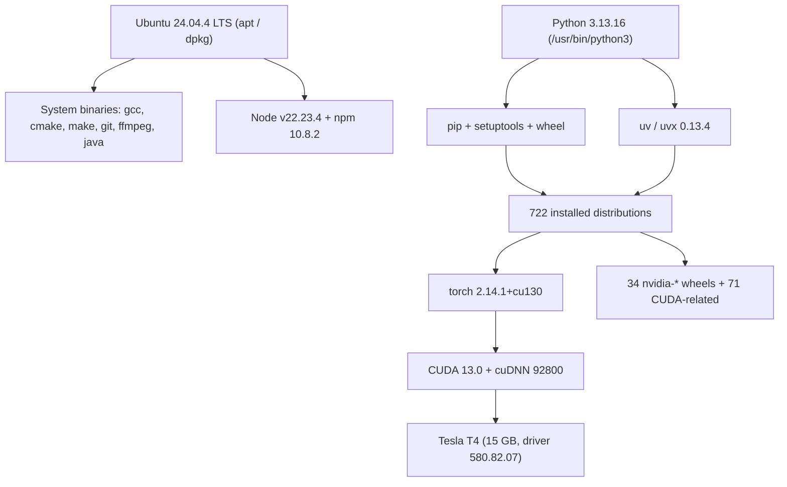

# Colab Environment Inventory — H5-OmniFusion

**Document ID:** COLAB_ENVIRONMENT_INVENTORY_ASD-STE100
**Timestamp:** 2026-11-11 (UTC).
**Capture date:** 2026-11-11, during this session. One Colab cell produced the data.
**Runtime captured:** Google Colab, Tesla T4 GPU runtime.
**Status:** Factual record. This document changes nothing.

> NOTE: This is a snapshot. It records the environment at capture time, before
> the later install cell. Section 12 lists the changes made after capture.

---

## 1. Purpose

This document records every package system present in the specific Colab virtual
machine that the agent inventoried. It gives the exact code that produced the
data. It gives the full results. The user can reproduce the inventory with the
same cell.

**Headline counts (verified):**

- **722 pip distributions** installed.
- **21 toolchain binaries** checked: 15 present, 6 absent.
- **40 key Python packages** checked: 30 present, 10 absent.
- **71 CUDA-related** distributions; **34** start with `nvidia-`.

---

## 2. Glossary

| Term | Definition |
|------|------------|
| package system | A tool that installs and manages software. Example: pip, apt, npm. |
| pip | The Python package installer. It installs wheels. |
| wheel | A built Python package file (`.whl`). |
| distribution | One installed pip package. The inventory counts these. |
| uv / uvx | A fast Python package installer and runner. Version 0.13.4 here. |
| apt / dpkg | The Ubuntu system package manager. It manages `.deb` packages. |
| npm | The Node.js package manager. |
| cargo / rustc | The Rust package manager and compiler. Absent at capture. |
| GIL | The Python Global Interpreter Lock. Enabled here. |
| free-threaded | A Python build without the GIL. This build is NOT free-threaded. |
| CUDA | The NVIDIA GPU compute platform. Version 13.0 here. |
| cuDNN | The NVIDIA deep-learning GPU library. Version 92800 here. |
| toolchain | Compilers and build tools: gcc, cmake, make, and similar. |

---

## 3. Package systems present

The VM has more than one package system. Each manages a different layer.

| Package system | Version | Layer | Evidence |
|----------------|---------|-------|----------|
| pip | present (version not captured) | Python wheels | `pip` in the 722 list |
| setuptools | present (version not captured) | Python build | `setuptools` in the 722 list |
| wheel | present (version not captured) | Python build | `wheel` in the 722 list |
| uv | 0.13.4 | Python wheels (fast) | toolchain capture |
| uvx | 0.13.4 | Python tool runner | toolchain capture |
| apt / dpkg | present (Ubuntu base) | System `.deb` | Ubuntu 24.04; `python-apt` in list |
| npm | 10.8.2 | Node.js packages | toolchain capture |
| cargo / rustc | **ABSENT at capture** | Rust crates | toolchain capture (added later, Section 12) |

> NOTE: pip and uv both manage Python wheels. apt manages system libraries. npm
> manages Node.js packages. The 722 count is the pip/uv layer only. It does not
> count apt `.deb` packages or npm packages.

### 3.1 Package-system diagram



---

## 4. System facts

| Property | Value |
|----------|-------|
| OS | Ubuntu 24.04.4 LTS (Noble Numbat) |
| Kernel | Linux-6.6.159+-x86_64-with-glibc2.39 |
| Architecture | x86_64 |
| CPU cores | 2 |
| RAM | 13.6 GB |
| Disk `/content` | 120.8 GB free / 120.9 GB total |

---

## 5. Python runtime

| Property | Value |
|----------|-------|
| Version | 3.13.16 (main, Oct 1 2026, 15:40:24) [GCC 13.3.0] |
| Executable | `/usr/bin/python3` |
| Free-threaded (no GIL) | **False** |
| GIL enabled now | **True** |

> WARNING: This Python is NOT free-threaded. The GIL is enabled. Do not assume
> no-GIL parallelism. Use Rust (releases the GIL) or multiprocessing for speed.

---

## 6. GPU / CUDA stack

| Property | Value |
|----------|-------|
| GPU | Tesla T4 |
| GPU memory | 15360 MiB (15 GB) |
| Driver | 580.82.07 |
| nvcc | present (CUDA compiler driver) |
| torch | 2.14.1+cu130 |
| torch CUDA | 13.0 |
| CUDA available | True |
| Device capability | (7, 5) |
| cuDNN | 92800 |

---

## 7. Toolchain / binaries (21 checked)

15 present, 6 absent. The version column shows the
first line of `<tool> --version`, truncated to 48 characters.

| Binary | State | Version / path detail |
|--------|-------|-----------------------|
| `gcc` | present | gcc (Ubuntu 13.3.0-6ubuntu2~24.04.1) 13.3.0 |
| `g++` | present | g++ (Ubuntu 13.3.0-6ubuntu2~24.04.1) 13.3.0 |
| `cmake` | present | cmake version 3.31.10 |
| `make` | present | GNU Make 4.3 |
| `ninja` | ABSENT | - |
| `git` | present | git version 2.43.0 |
| `curl` | present | curl 8.5.0 (x86_64-pc-linux-gnu) libcurl/8.5.0 O |
| `wget` | present | GNU Wget 1.21.4 built on linux-gnu. |
| `rustc` | ABSENT | - |
| `cargo` | ABSENT | - |
| `uv` | present | uv 0.13.4 (x86_64-unknown-linux-gnu) |
| `uvx` | present | uvx 0.13.4 (x86_64-unknown-linux-gnu) |
| `ffmpeg` | present | ffmpeg version 6.1.1-3ubuntu5 Copyright (c) 2000 |
| `ffprobe` | present | ffprobe version 6.1.1-3ubuntu5 Copyright (c) 200 |
| `java` | present | [0.010s][warning][os,container] Cgroup memory co |
| `node` | present | v22.23.4 |
| `npm` | present | 10.8.2 |
| `go` | ABSENT | - |
| `pkg-config` | present | 1.8.1 |
| `swig` | ABSENT | - |
| `sqlite3` | ABSENT | - |

> NOTE: `rustc` and `cargo` are absent at capture. The later install cell adds
> Rust 1.99.1 via rustup (Section 12). `ninja`, `go`, `swig`, `sqlite3` are absent.

---

## 8. Key Python packages (40 checked)

30 present, 10 absent. These are the packages the
feature pipeline needs. The full list of 722 is in Section 10.

| Package | Version |
|---------|---------|
| `torch` | 2.14.1+cu130 |
| `torchvision` | 0.29.1+cu130 |
| `torchaudio` | 2.11.0+cu130 |
| `numpy` | 2.4.6 |
| `scipy` | 1.16.3 |
| `pandas` | 2.2.3 |
| `scikit-learn` | 1.6.1 |
| `transformers` | 5.22.1 |
| `tokenizers` | 0.23.3 |
| `huggingface-hub` | 1.33.0 |
| `datasets` | 4.8.5 |
| `accelerate` | 1.15.0 |
| `safetensors` | 0.8.0 |
| `opensmile` | ABSENT |
| `parselmouth` | ABSENT |
| `librosa` | 0.11.0 |
| `soundfile` | 0.14.0 |
| `noisereduce` | ABSENT |
| `pyannote.audio` | ABSENT |
| `opencv-python` | 5.0.0.93 |
| `mediapipe` | ABSENT |
| `Pillow` | 11.3.0 |
| `matplotlib` | 3.10.0 |
| `h5py` | 3.14.0 |
| `tables` | 3.10.2 |
| `nltk` | 3.9.1 |
| `spacy` | 3.8.18 |
| `sentencepiece` | 0.2.2 |
| `vaderSentiment` | ABSENT |
| `textblob` | 0.19.0 |
| `onnx` | ABSENT |
| `onnxruntime` | ABSENT |
| `triton` | 3.8.0 |
| `mcp` | ABSENT |
| `fastmcp` | ABSENT |
| `pydantic` | 2.14.2 |
| `jupyter_client` | 7.4.9 |
| `ipykernel` | 6.17.1 |
| `tqdm` | 4.67.3 |
| `requests` | 2.32.4 |

> NOTE: At capture, `opensmile`, `parselmouth`, `noisereduce`, `pyannote.audio`,
> `vaderSentiment`, `mediapipe`, `onnx`, `onnxruntime`, `mcp`, `fastmcp` are absent.
> The install cell adds several of these (Section 12). `mediapipe` has no Python
> 3.13 wheel; use `dlib` (present) for face landmarks.

---

## 9. Package-family chart

The chart counts the 722 pip distributions by name prefix. The prefix is the
first token before `-` or `_`. This is a factual count, not a category judgment.

```
nvidia         |################################## 34
google         |########################### 27
python         |########### 11
jupyter        |######## 8
sphinxcontrib  |###### 6
tensorflow     |###### 6
cuda           |##### 5
langgraph      |#### 4
opentelemetry  |#### 4
pandas         |#### 4
dask           |### 3
ipython        |### 3
```

- CUDA-related distributions (name contains `cu12`, `cu13`, `cuda`, or `nvidia`): **71**.
- Distributions starting `nvidia-`: **34**.
- Distributions starting `google-cloud-`: **15**.

---

## 10. Full pip inventory (722 distributions)

The complete alphabetical list, exactly as captured. 722 names. Wrapped eight
per line for reading. The order is the alphabetical sort produced by the cell.

```text
Authlib, Bottleneck, CacheControl, Cython, Farama-Notifications, Flask, GDAL, ImageIO
Jinja2, Mako, Markdown, MarkupSafe, PuLP, PyDrive2, PyGObject, PyJWT
PyOpenGL, PySocks, PyWavelets, PyYAML, Pygments, SQLAlchemy, SecretStorage, Send2Trash
Sphinx, Werkzeug, absl-py, accelerate, access, affine, aiofiles, aiohappyeyeballs
aiohttp, aiosignal, aiosqlite, alabaster, albucore, albumentations, ale-py, altair
annotated-doc, annotated-types, anyio, anywidget, apsw, argon2-cffi, argon2-cffi-bindings, array_record
arrow, arviz, astropy, astropy-iers-data, astunparse, atpublic, attrs, audioop-lts
audioread, autograd, babel, backcall, beartype, beautifulsoup4, betterproto, bigframes
bigquery-magics, bleach, blinker, blis, blobfile, blosc2, bokeh, bqplot
branca, brotli, cachetools, catalogue, certifi, cffi, chardet, charset-normalizer
clarabel, click, cligj, cloudpathlib, cloudpickle, cmake, cmdstanpy, colorcet
colorlover, community, confection, cons, contourpy, cpsat-logutils, cramjam, cryptography
cucim-cu13, cuda-bindings, cuda-core, cuda-pathfinder, cuda-python, cuda-toolkit, cudf-cu13, cudf-polars-cu13
cufflinks, cuml-cu13, cupy-cuda13x, curl_cffi, cuvs-cu13, cvxopt, cvxpy, cycler
cyipopt, cymem, dask, dask-cuda, dask-cudf-cu13, dataproc-spark-connect, datasets, db-dtypes
dbus-python, debugpy, decorator, defusedxml, deprecation, diffusers, dill, distributed
distributed-ucxx-cu13, distro, dlib, dm-tree, docstring_parser, docutils, dopamine_rl, duckdb
earthengine-api, easydict, editdistance, eerepr, einops, en_core_web_sm, entrypoints, esda
et_xmlfile, etils, etuples, fastai, fastapi, fastcore, fastdownload, fastjsonschema
fastprogress, fasttransform, filelock, firebase-admin, flatbuffers, flax, folium, fonttools
formulaic, fqdn, frozendict, frozenlist, fsspec, future, gast, gcsfs
gdown, geemap, geocoder, geographiclib, geopandas, geopy, giddy, gin-config
glob2, google, google-adk, google-api-core, google-api-python-client, google-auth, google-auth-httplib2, google-auth-oauthlib
google-cloud-bigquery, google-cloud-bigquery-connection, google-cloud-bigquery-storage, google-cloud-core, google-cloud-dataproc, google-cloud-datastore, google-cloud-firestore, google-cloud-functions
google-cloud-language, google-cloud-monitoring, google-cloud-resource-manager, google-cloud-spanner, google-cloud-storage, google-cloud-storage-control, google-cloud-translate, google-colab
google-crc32c, google-genai, google-pasta, google-resumable-media, googleapis-common-protos, googledrivedownloader, gradio, gradio_client
grain, graphviz, groovy, grpc-google-iam-v1, grpc-interceptor, grpcio, grpcio-status, grpclib
gspread, gspread-dataframe, gym, gym-notices, gymnasium, h11, h2, h5netcdf
h5py, hdbscan, hf-gradio, hf-xet, highspy, holidays, holoviews, hpack
html5lib, httpcore, httpcore2, httpimport, httplib2, httptools, httpx, httpx2
huggingface_hub, humanize, hyperframe, hyperopt, ibis-framework, idna, imageio-ffmpeg, imagesize
imbalanced-learn, immutabledict, importlib_metadata, imutils, inequality, inflect, iniconfig, intel-cmplr-lib-ur
intel-openmp, interface_meta, ipyevents, ipyfilechooser, ipykernel, ipyleaflet, ipyparallel, ipython
ipython-genutils, ipython-sql, ipywidgets, isoduration, itsdangerous, jaraco.classes, jaraco.context, jaraco.functools
jax, jax-cuda13-pjrt, jax-cuda13-plugin, jaxlib, jeepney, jieba, jiter, joblib
joserfc, jsonpatch, jsonpickle, jsonpointer, jsonschema, jsonschema-specifications, jupyter-console, jupyter-events
jupyter-leaflet, jupyter_client, jupyter_core, jupyter_kernel_gateway, jupyter_server, jupyter_server_terminals, jupyterlab_pygments, jupyterlab_widgets
jupytext, kaggle, kagglehub, kagglesdk, keras, keras-hub, keras-nlp, keyring
keyrings.google-artifactregistry-auth, kiwisolver, langchain, langchain-core, langchain-protocol, langgraph, langgraph-checkpoint, langgraph-prebuilt
langgraph-sdk, langsmith, lark, launchpadlib, lazr.restfulclient, lazr.uri, lazy-loader, libclang
libcudf-cu13, libcugraph-cu13, libcuml-cu13, libcuvs-cu13, libkvikio-cu13, libnvforest-cu13, libpysal, libraft-cu13
librapidsmpf-cu13, librmm-cu13, librosa, libucx-cu13, libucxx-cu13, lightgbm, linkify-it-py, llvmlite
locket, logical-unification, lxml, lz4, mapclassify, markdown-it-py, matplotlib, matplotlib-inline
matplotlib-venn, mdit-py-plugins, mdurl, mgwr, miniKanren, missingno, mistune, mizani
mkl, ml_dtypes, mlxtend, mmh3, momepy, more-itertools, moviepy, mpmath
msgpack, multidict, multipledispatch, multiprocess, multitasking, murmurhash, music21, namex
narwhals, natsort, nbclassic, nbclient, nbconvert, nbformat, ndindex, nest-asyncio
networkx, nh3, nibabel, nltk, notebook, notebook_shim, numba, numba-cuda
numexpr, numpy, nvforest-cu13, nvidia-cublas, nvidia-cublas-cu12, nvidia-cuda-cccl, nvidia-cuda-crt, nvidia-cuda-cupti
nvidia-cuda-cupti-cu12, nvidia-cuda-nvcc, nvidia-cuda-nvcc-cu12, nvidia-cuda-nvrtc, nvidia-cuda-nvrtc-cu12, nvidia-cuda-runtime, nvidia-cuda-runtime-cu12, nvidia-cudnn-cu12
nvidia-cudnn-cu13, nvidia-cufft, nvidia-cufft-cu12, nvidia-cufile, nvidia-curand, nvidia-curand-cu12, nvidia-cusolver, nvidia-cusolver-cu12
nvidia-cusparse, nvidia-cusparse-cu12, nvidia-cusparselt-cu13, nvidia-libnvcomp-cu13, nvidia-ml-py, nvidia-nccl-cu12, nvidia-nccl-cu13, nvidia-nvimgcodec-cu13
nvidia-nvjitlink, nvidia-nvjitlink-cu12, nvidia-nvshmem-cu13, nvidia-nvtx, nvidia-nvvm, nvtx, nx-cugraph-cu13, oauth2client
oauthlib, omegaconf, onemkl-license, openai, opencv-contrib-python, opencv-python, opencv-python-headless, openpyxl
opentelemetry-api, opentelemetry-resourcedetector-gcp, opentelemetry-sdk, opentelemetry-semantic-conventions, opt_einsum, optax, optree, orbax-checkpoint
orjson, orloge, ormsgpack, osqp, packaging, pandas, pandas-datareader, pandas-gbq
pandas-stubs, pandocfilters, panel, panel-material-ui, param, parso, parsy, partd
patsy, peewee, peft, pexpect, pickleshare, pillow, pip, platformdirs
plotly, plotnine, pluggy, plum-dispatch, pointpats, polars, polars-runtime-32, pooch
portpicker, preshed, prettytable, proglog, progressbar2, prometheus_client, promise, prompt_toolkit
propcache, prophet, proto-plus, protobuf, psutil, psycopg2, psygnal, ptyprocess
py-cpuinfo, py4j, pyOpenSSL, pyarrow, pyasn1, pyasn1_modules, pycairo, pycocotools
pycparser, pycryptodomex, pydantic, pydantic_core, pydata-google-auth, pydot, pydotplus, pydub
pyerfa, pygame, pygit2, pyiceberg, pylibcudf-cu13, pylibcugraph-cu13, pylibraft-cu13, pymc
pynndescent, pyogrio, pyomo, pyparsing, pyperclip, pyproj, pyroaring, pysal
pyshp, pyspark, pytensor, pytest, python-apt, python-box, python-dateutil, python-dotenv
python-fasthtml, python-json-logger, python-louvain, python-multipart, python-slugify, python-snappy, python-utils, pytz
pyviz_comms, pyzmq, quantecon, raft-dask-cu13, rapids-dask-dependency, rapids-logger, rapidsmpf-cu13, rasterio
rasterstats, ratelim, referencing, regex, requests, requests-oauthlib, requests-toolbelt, requirements-parser
rfc3339-validator, rfc3986-validator, rfc3987-syntax, rich, rmm-cu13, roman-numerals, roman-numerals-py, rpds-py
rpy2, rsa, rtree, safehttpx, safetensors, scikit-image, scikit-learn, scipy
scooby, scs, seaborn, segregation, semantic-version, sentence-transformers, sentencepiece, sentry-sdk
setuptools, shap, shapely, shellingham, simple-parsing, simplejson, simsimd, six
sklearn-compat, sklearn-pandas, slicer, smart_open, sniffio, snowballstemmer, sortedcontainers, soundfile
soupsieve, soxr, spacy, spacy-legacy, spacy-loggers, spaghetti, spanner-graph-notebook, spglm
sphinxcontrib-applehelp, sphinxcontrib-devhelp, sphinxcontrib-htmlhelp, sphinxcontrib-jsmath, sphinxcontrib-qthelp, sphinxcontrib-serializinghtml, spint, splot
spopt, spreg, sqlglot, sqlparse, srsly, standard-aifc, standard-chunk, standard-sunau
stanio, starlette, statsmodels, strictyaml, stringzilla, stumpy, sympy, tables
tabulate, tbb, tblib, tcmlib, tenacity, tensorboard, tensorboard-data-server, tensorflow
tensorflow-datasets, tensorflow-hub, tensorflow-metadata, tensorflow-probability, tensorflow-text, tensorstore, termcolor, terminado
text-unidecode, textblob, tf-slim, tf_keras, thinc, threadpoolctl, tifffile, tiktoken
timm, tinycss2, tobler, tokenizers, toml, tomlkit, toolz, torch
torchao, torchaudio, torchcodec, torchdata, torchsummary, torchtune, torchvision, tornado
tqdm, traitlets, traittypes, transformers, treelite, treescope, triton, truststore
tsfresh, tweepy, typeguard, typer, types-pytz, types-setuptools, typing-inspection, typing_extensions
tzdata, tzlocal, ucxx-cu13, umap-learn, umf, uri-template, uritemplate, urllib3
uuid_utils, uvicorn, uvloop, vega-datasets, wadllib, wandb, wasabi, watchdog
watchfiles, wcwidth, weasel, webcolors, webencodings, websocket-client, websockets, wheel
widgetsnbextension, wordcloud, wrapt, xarray, xarray-einstats, xee, xgboost, xlrd
xxhash, xyzservices, yarl, ydf, ydf_tf, yellowbrick, yfinance, zict
zipp, zstandard
```

---

## 11. The exact code used

One Colab cell produced all data above. Paste it and run it. It uses only the
Python standard library plus `torch` (already installed). It installs nothing.

### 11.1 How the code works

| Section | Mechanism | Output |
|---------|-----------|--------|
| SYSTEM | `/etc/os-release`, `platform`, `os.cpu_count`, `os.sysconf`, `shutil.disk_usage` | OS, kernel, cores, RAM, disk |
| PYTHON | `sys.version`, `sysconfig.get_config_var("Py_GIL_DISABLED")`, `sys._is_gil_enabled()` | version, GIL state |
| GPU / CUDA | `nvidia-smi` query, `nvcc --version`, `torch.cuda` | GPU, driver, CUDA, cuDNN |
| TOOLCHAIN | `shutil.which` + `<tool> --version` for 21 binaries | present/absent + version |
| KEY PACKAGES | `importlib.metadata.version` for 40 names | version or absent |
| ALL PIP | `importlib.metadata.distributions()` then unique names then sort | the 722 list |

> NOTE: The cell reads metadata only. It does not import each package. So an
> absent package reports `(absent)` without raising. The `run()` helper times out
> at 30 seconds and returns the first output line.

### 11.2 The cell

```python
# Colab environment inventory - one cell, paste and run.
import sys, os, sysconfig, platform, shutil, subprocess, importlib.metadata as md

def run(cmd):
    try:
        p = subprocess.run(cmd, shell=isinstance(cmd, str), capture_output=True, text=True, timeout=30)
        out = (p.stdout or p.stderr).strip()
        return out.splitlines()[0] if out else "(empty)"
    except Exception:
        return "(not available)"

def ver(pkg):
    try: return md.version(pkg)
    except Exception: return None

print("="*70, "\nSYSTEM\n", "="*70, sep="")
try:
    for line in open("/etc/os-release"):
        if line.startswith(("PRETTY_NAME", "VERSION=")): print(" ", line.strip())
except Exception: pass
print("  Platform :", platform.platform(), "|", platform.machine())
print("  CPU cores:", os.cpu_count())
try: print("  RAM      : %.1f GB" % (os.sysconf("SC_PAGE_SIZE")*os.sysconf("SC_PHYS_PAGES")/1e9))
except Exception: pass
du = shutil.disk_usage("/content")
print("  Disk /content: %.1f GB free / %.1f GB total" % (du.free/1e9, du.total/1e9))

print("\n" + "="*70, "\nPYTHON\n", "="*70, sep="")
print("  Version  :", sys.version.replace("\n", " "))
print("  Exec     :", sys.executable)
print("  Free-threaded (no GIL):", bool(sysconfig.get_config_var("Py_GIL_DISABLED")))
try: print("  GIL enabled now:", sys._is_gil_enabled())
except Exception: pass

print("\n" + "="*70, "\nGPU / CUDA\n", "="*70, sep="")
print("  nvidia-smi:", run("nvidia-smi --query-gpu=name,memory.total,driver_version --format=csv,noheader"))
nvcc = shutil.which("nvcc") or "/usr/local/cuda/bin/nvcc"
print("  nvcc     :", run([nvcc, "--version"]) if os.path.exists(nvcc) else "(not found)")
try:
    import torch
    print("  torch    :", torch.__version__, "| CUDA:", torch.version.cuda, "| available:", torch.cuda.is_available())
    if torch.cuda.is_available():
        print("  device   :", torch.cuda.get_device_name(0), "| capability:", torch.cuda.get_device_capability(0))
    print("  cuDNN    :", torch.backends.cudnn.version())
except Exception as e:
    print("  torch    : (not importable)", e)

print("\n" + "="*70, "\nTOOLCHAIN / BINARIES\n", "="*70, sep="")
for t in ["gcc","g++","cmake","make","ninja","git","curl","wget","rustc","cargo",
          "uv","uvx","ffmpeg","ffprobe","java","node","npm","go","pkg-config","swig","sqlite3"]:
    path = shutil.which(t)
    print("  %-10s %s" % (t, (path + " | " + run([t, "--version"])[:55]) if path else "(not installed)"))

print("\n" + "="*70, "\nKEY PYTHON PACKAGES\n", "="*70, sep="")
for p in ["torch","torchvision","torchaudio","numpy","scipy","pandas","scikit-learn",
          "transformers","tokenizers","huggingface-hub","datasets","accelerate","safetensors",
          "opensmile","parselmouth","librosa","soundfile","noisereduce","pyannote.audio",
          "opencv-python","mediapipe","Pillow","matplotlib","h5py","tables","nltk","spacy",
          "sentencepiece","vaderSentiment","textblob","onnx","onnxruntime","triton",
          "mcp","fastmcp","pydantic","jupyter_client","ipykernel","tqdm","requests"]:
    print("  %-20s %s" % (p, ver(p) or "(absent)"))

names = set()
for d in md.distributions():
    try:
        n = d.metadata["Name"]
        if n: names.add(n)
    except Exception: pass
allp = sorted(names)
print("\n" + "="*70, "\nALL PIP PACKAGES: %d installed\n" % len(allp), "="*70, sep="")
print(", ".join(allp))
```

---

## 12. Changes after capture (separate, dated)

The snapshot above is the pre-install state. A later install cell changed it.
These changes are NOT part of the 722 snapshot.

| Item | At capture | After install cell | Note |
|------|------------|--------------------|------|
| opensmile | absent | installed | eGeMAPS audio features |
| noisereduce | absent | installed | audio denoise |
| vaderSentiment | absent | installed | text sentiment |
| pyannote.audio | absent | installed | speaker diarization |
| rustc / cargo | absent | 1.99.1 (rustup) | Rust toolchain |
| parselmouth | absent | wrong package | PyPI `parselmouth` is an ad library, not Praat. Real Praat is `praat-parselmouth` (no cp313 wheel). Use opensmile fallback. |
| mediapipe | absent | not installed | no Python 3.13 wheel; use dlib |
| torch | 2.14.1+cu130 | unchanged | installs did not alter torch |

> WARNING: Do not treat the post-install state as the 722 snapshot. Re-run the
> cell to capture a fresh, exact inventory after any install.

---

## 13. Provenance and verification

| Claim | Evidence |
|-------|----------|
| 722 pip distributions | `importlib.metadata.distributions()` count; list parsed and asserted = 722 |
| 21 binaries, 15 present | toolchain section parsed from capture |
| 40 key packages, 30 present | key-package section parsed from capture |
| GPU Tesla T4, CUDA 13.0 | `nvidia-smi` + `torch.cuda` capture |
| GIL enabled | `sys._is_gil_enabled()` = True; `Py_GIL_DISABLED` = False |
| Code is exact | retrieved verbatim from the session transcript |

### 13.1 Verification checklist

- [x] Timestamp present (2026-11-11).
- [x] Exact code cell included (Section 11.2).
- [x] All 722 pip distributions listed (Section 10).
- [x] Package systems documented: pip, uv/uvx, apt/dpkg, npm (Section 3).
- [x] Real counts: 722 pip, 21 binaries, 40 key packages.
- [x] At least one diagram (mermaid) and one chart (ASCII).
- [x] Post-capture changes separated and dated (Section 12).

---

*End of inventory. This document records facts only. Re-run the cell to refresh.*
