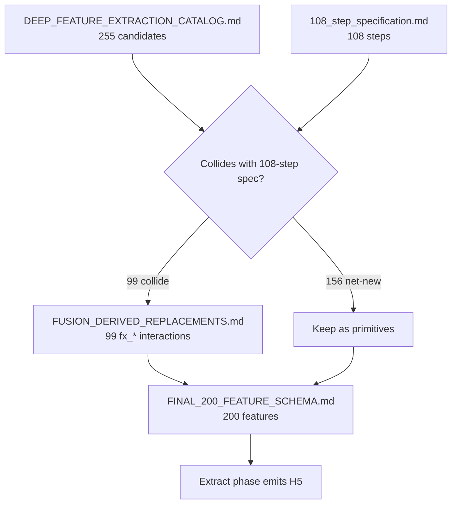
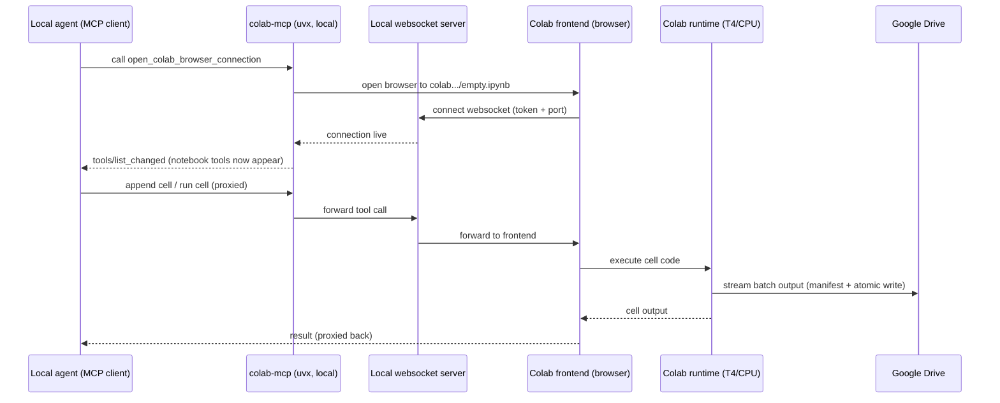
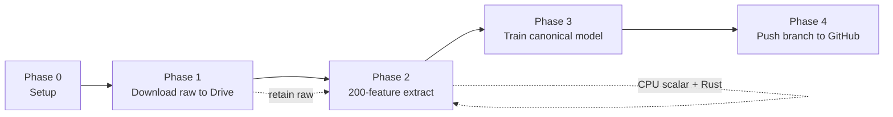
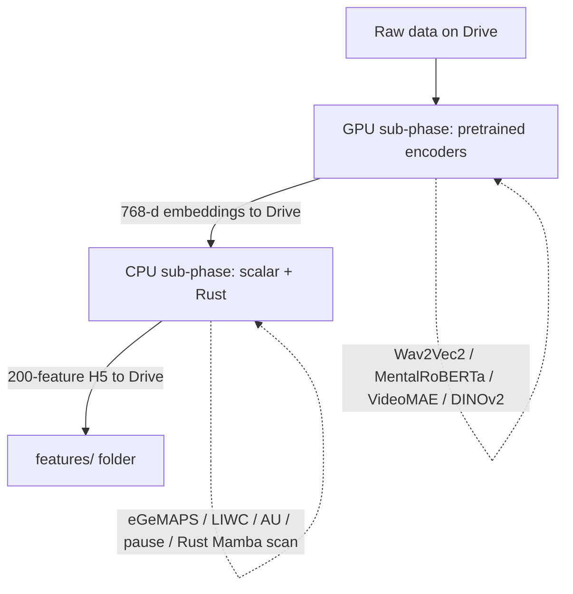
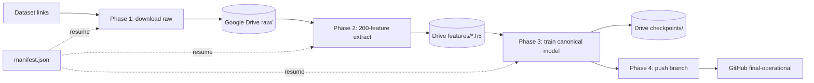

# Colab Execution Plan — H5-OmniFusion

**Document standard:** ASD-STE100 Issue 9 (Simplified Technical English).
**Version:** 1.0  **Date:** 2026-11-11  **Status:** Plan for approval.
**Goal:** Download the data, extract 200 features, train the model, push to GitHub.

> WARNING: This document is a plan. Do not run downloads, delete code, or push to
> GitHub until the user approves each phase. A push to GitHub is a shared action.
> It is visible to others. Confirm before you push.

---

## 1. Purpose

This plan gives the exact steps to make the project operational on Google Colab.
The work has four phases. Each phase streams its output to Google Drive.

1. **Download.** Get the raw dataset from the given links. Save it to Drive. Keep it.
2. **Extract.** Compute the 200 features from the raw data. Save H5 files to Drive.
3. **Train.** Train the H5-OmniFusion model on the H5 files. Save checkpoints to Drive.
4. **Push.** Commit the work to a branch. Push the branch to GitHub.

The download phase only downloads. It does not preprocess. This is a deliberate
correction. The raw data stays on Drive until the extract phase uses it.

---

## 2. Controlled terms

| Term | Definition |
|------|------------|
| Colab MCP | The `googlecolab/colab-mcp` server. It bridges a local agent to a Colab browser session. |
| Bridge | A local server that forwards tool calls to the Colab frontend over a websocket. |
| Frontend | The Colab notebook UI in the browser. It provides the notebook tools. |
| Runtime | The Colab VM. The user selects GPU (T4) or CPU. |
| Raw data | The downloaded dataset files, before any processing. |
| H5 | An HDF5 feature file for one participant. |
| Manifest | A Drive-side JSON record of completed batches. It enables resume. |
| Atomic write | Write to a temp file, then rename. A partial file never appears as final. |
| Canonical | The one correct model copy in `src/models/`. |
| Branch | A git line of work. `main` stays untouched. The branch holds the new work. |

Technical names, paths, and code identifiers stay exactly as written.

---

## 3. Reference files (the specific files this plan uses)

This plan depends on the files below. Each file has a defined role.

| File | Role | Key count |
|------|------|-----------|
| `FINAL_200_FEATURE_SCHEMA.md` | The collision-free feature schema. The extract phase emits these. | 200 features |
| `DEEP_FEATURE_EXTRACTION_CATALOG.md` | The full manual feature catalog. The "high number" of extraction signals. | 255 candidates |
| `FUSION_DERIVED_REPLACEMENTS.md` | The fusion-derived replacements for the 99 collisions. | 99 `fx_*` rows |
| `docs/ml_pipeline/108_step_specification.md` | The extraction architecture: 40 production + 59 research + 9 advanced steps. | 108 steps |
| `docs/ml_pipeline/ARCHITECTURE.md` | The model architecture description. | — |
| `OPERATIONAL_CODE_AUDIT_ASD-STE100.md` | The KEEP/DELETE/FIX audit. It names the canonical training stack. | 206 files audited |
| `AGENTS.md` | The hard rules: append-only, Drive streaming, schema, STE100. | — |
| `ml_pipeline/h5_omnifusion/scripts/train.py` | The correct training entry point. | 159 LOC |
| `ml_pipeline/h5_omnifusion/src/models/h5_omnifusion.py` | The canonical model. It takes one `config` object. | 209 LOC |
| `ml_pipeline/h5_omnifusion/src/training/trainer.py` | The correct trainer. It reads `binary_logit` and `phq_score`. | 494 LOC |
| `ml_pipeline/h5_omnifusion/src/data/h5_dataset.py` | The H5 loader and k-fold dataloaders. | 620 LOC |
| `ml_pipeline/h5_omnifusion/config/model_config.py` | `H5Config` and `ComputeTier` (NANO/MICRO/MEDIUM). | 207 LOC |

> CAUTION: Do not use the top-level `training/` package. It is broken. The audit
> (Section 8.3) gives the evidence. Use `scripts/train.py` with `src/` only.

### 3.1 How the feature files relate



The 200-schema is the contract. The catalog is the source pool. The replacements
resolve the collisions. The extract phase emits exactly the 200-schema columns.

---

## 4. The Colab MCP — verified facts

This section states what the installed package actually does. The facts come from
the cached source (`colab_mcp` 1.0.1) and its README. They are not guesses.

### 4.1 Installation (confirmed)

| Item | Value |
|------|-------|
| Package | `googlecolab/colab-mcp` version 1.0.1 |
| Runner | `uvx` (uv 0.13.7 is installed) |
| Command | `uvx git+https://github.com/googlecolab/colab-mcp` |
| Console script | `colab-mcp = colab_mcp:main` |
| Python | requires >= 3.13 (Python 3.13 is installed; uvx builds its own env) |
| Key deps | `fastmcp==2.14.5`, `websockets>=15.0.1`, `jupyter-kernel-client`, `mcp[cli]` |
| Current config | `C:/Users/NITHING/.gemini/config/mcp_config.json` (Gemini/Antigravity) |
| Qoder config | NOT registered. The 7 Qoder MCP servers are all plugins. |

### 4.2 How the bridge works

The server does not download data or train models itself. It is a bridge. The
real work runs in Colab cells. The agent edits and runs those cells through the
bridge.



### 4.3 Verified behavior

- The server starts a local websocket on `localhost:<random port>` with a secret token.
- It exposes one built-in tool: `open_colab_browser_connection`.
- That tool opens the browser to
  `https://colab.research.google.com/notebooks/empty.ipynb#mcpProxyToken=<token>&mcpProxyPort=<port>`.
- The user connects in the browser. The wait timeout is 60 seconds.
- After connection, the Colab frontend provides the notebook tools through the proxy.
  The tool list changes dynamically (`notifications/tools/list_changed`).
- Only one Colab session can connect at a time (single-client exclusivity).
- Allowed origins: `colab.research.google.com` and `colab.google.com`.

> WARNING: The notebook tools are injected by the Colab frontend after connection.
> Their exact names are dynamic. This plan does not invent tool names. The agent
> reads the live tool list after connection, then uses the cell tools.

### 4.4 Client support — the key caveat

The README requires a client that supports `notifications/tools/list_changed` and
runs locally. It lists these supported clients: **Gemini CLI, Claude Code, Windsurf**.
**Qoder is not on that list.**

| Option | Venue | Status | Action |
|--------|-------|--------|--------|
| A (recommended) | Gemini CLI / Claude Code / Windsurf | Confirmed supported. Gemini config already exists. | Run the workflow from that client. |
| B | Qoder | Not confirmed. Depends on `tools/list_changed` support. | Register the server, then test if notebook tools appear after connect. |

To register in Qoder (Option B), add this MCP connector via `manage_app_mcp add`:

```json
{
  "name": "colab-mcp",
  "config": {
    "command": "uvx",
    "args": ["git+https://github.com/googlecolab/colab-mcp"],
    "timeout": 600000
  }
}
```

> CAUTION: Adding an MCP connector changes the app configuration. Do this only with
> user approval. After you add it, call `open_colab_browser_connection`, connect in
> the browser, and confirm the notebook tools appear. If they do not appear, Qoder
> does not support the dynamic tool list. Use Option A instead.

### 4.5 Verify the package runs

Run this once to confirm the server starts (first run may use the network; later
runs use the uv cache):

```bash
uvx git+https://github.com/googlecolab/colab-mcp --help
```

---

## 5. Phase overview

| Phase | Runtime | Input | Output | Code entry |
|-------|---------|-------|--------|------------|
| 0 Setup | local | — | branch + bridge + Drive mount | git, uvx, Colab UI |
| 1 Download | CPU | dataset links | raw data on Drive | append-only cells |
| 2 Extract | GPU then CPU | raw data on Drive | 200-feature H5 on Drive | `pipeline_fusion_main.py` + catalog |
| 3 Train | GPU | H5 on Drive | checkpoints on Drive | `scripts/train.py` |
| 4 Push | local | branch | GitHub branch | git |



---

## 6. Drive layout (hierarchical tree)

All output goes to a new dated folder. Never overwrite old output.

```text
/content/drive/MyDrive/DAIC-WOZ_Datasets/
├── pretrained_models/                  KEEP (load local-only)
└── runs/
    └── 2026-11-11_200feat/             NEW dated run folder
        ├── raw/                        Phase 1 output (retain)
        │   ├── DAIC-WOZ/
        │   ├── Extended-DAIC/
        │   └── EATD-Corpus/
        ├── features/                   Phase 2 output
        │   ├── DAIC-WOZ/<pid>.h5
        │   ├── Extended-DAIC/<pid>.h5
        │   └── EATD-Corpus/<pid>.h5
        ├── checkpoints/                Phase 3 output
        │   ├── fold0/best.pt
        │   └── ...
        ├── labels/                     consolidated labels.csv
        ├── manifest.json               completed-batch record (resume)
        └── logs/
```

### 6.1 Manifest and atomic write (the resume contract)

Every batch writes through this pattern. A VM restart never loses a saved batch.

```python
import os, json, tempfile

def atomic_write_json(path, obj):
    d = os.path.dirname(path)
    fd, tmp = tempfile.mkstemp(dir=d, suffix=".tmp")
    with os.fdopen(fd, "w") as f:
        json.dump(obj, f)
    os.replace(tmp, path)            # atomic on POSIX; temp -> final

def mark_done(manifest_path, batch_id, out_path):
    m = json.load(open(manifest_path)) if os.path.exists(manifest_path) else {"done": {}}
    m["done"][batch_id] = out_path
    atomic_write_json(manifest_path, m)

def already_done(manifest_path, batch_id):
    if not os.path.exists(manifest_path):
        return False
    return batch_id in json.load(open(manifest_path)).get("done", {})
```

> WARNING: A Colab VM can disconnect at any time. Save each batch to Drive as it
> completes. Write the manifest after the data file. On resume, skip done batches.
> Do not hold completed work only on the VM disk.

---

## 7. Phase 0 — Setup

### 7.1 Steps

1. Create the work branch. Keep `main` untouched.

   ```bash
   git checkout -b final-operational
   ```

   For a fresh, light history instead, use an orphan branch:

   ```bash
   git checkout --orphan final-operational
   ```

2. Choose the Colab MCP client (Section 4.4). Option A is confirmed supported.
3. If Option B, register the connector in Qoder (Section 4.4) with approval.
4. Start the bridge. Call `open_colab_browser_connection`.
5. Connect in the browser within 60 seconds.
6. Confirm the notebook tools appear in the live tool list.
7. Mount Drive in a Colab cell:

   ```python
   from google.colab import drive
   drive.mount('/content/drive')
   ```

8. Create the new dated run folder (Section 6).
9. Set the runtime to CPU for Phase 1. The user does this in the Colab UI.

> CAUTION: The user selects the runtime manually. The agent cannot change the
> Colab runtime type. Ask the user to set GPU (T4) or CPU at each phase boundary.

### 7.2 Prerequisites the user must provide

| Item | Status | Note |
|------|--------|------|
| Extended-DAIC link | RECEIVED | See Section 7.3, dataset 1. Open access. |
| DAIC-WOZ link | Pending | DAIC-WOZ needs the ISI USC access form. It is not a public direct link. |
| EATD-Corpus link | Pending | The user will provide the URL. |
| Fourth dataset link | Pending | The user will name and provide it. |
| Colab MCP client choice | Decision needed | Option A (supported) or Option B (test Qoder). |
| Google Drive auth | User action | The browser mount prompts the user. |
| GitHub remote + auth | Confirm | The push target and credentials. |

> WARNING: Do not invent dataset URLs. DAIC-WOZ is access-controlled. Wait for the
> user to provide the remaining links and confirm access before Phase 1.

### 7.3 Dataset sources (verified)

The user provides four datasets. This table tracks each source. Do not download
until the user confirms the link and access.

| # | Dataset | Status | Access | URL |
|---|---------|--------|--------|-----|
| 1 | Extended-DAIC (E-DAIC) | RECEIVED | Open (downloads only) | `https://dcapswoz.ict.usc.edu/wwwedaic/?dir=%20File%20Index` |
| 2 | DAIC-WOZ | Pending | Controlled (ISI USC form) | Not provided |
| 3 | EATD-Corpus | Pending | Not confirmed | Not provided |
| 4 | Fourth dataset | Pending | Not confirmed | Not provided |
| 5 | D-Vlog (auxiliary open video) | RECEIVED (CSV only) | YouTube (verify ToS) | `dvlog-video-links.csv` (961 rows) |

> NOTE: D-Vlog is not a clinical source. It is an auxiliary open-video set. It
> supplies raw video and binary labels, but no PHQ-8 score. See the feasibility
> matrix, Section 11.5, for the verified statistics and limits.

#### Dataset 5 — D-Vlog (auxiliary) download rule

1. The received file is `dvlog-video-links.csv`. It holds metadata only.
2. The raw video is not present. Each row gives a YouTube ID in the `key` column.
3. Do not bulk-download the 961 videos until the user confirms the plan.
4. Respect the YouTube terms of service and the dataset license.
5. Use D-Vlog for extractor validation and a binary auxiliary task only.

> WARNING: D-Vlog has no PHQ-8 ground truth and no interviewer turns. Do not use
> it as the labeled depression-training set. Keep E-DAIC / DAIC-WOZ for labels.

#### Dataset 1 — Extended-DAIC (E-DAIC) verified layout

The agent inspected the index on 2026-11-11. The layout is:

```
wwwedaic/
├── data/                         # per-participant archives
│   ├── 300_P.tar.gz              # one archive per participant ID
│   ├── 301_P.tar.gz
│   └── ...
├── labels/
│   ├── Detailed_PHQ8_Labels.csv  # PHQ-8 item scores per participant
│   ├── detailed_lables.csv       # note: source spells "lables"
│   ├── train_split.csv           # official train participant IDs
│   ├── dev_split.csv             # official dev participant IDs
│   └── test_split.csv            # official test participant IDs
├── E-DAIC Manual.pdf             # documentation
├── labels2019.tar.gz             # 2019 label bundle
├── metadata_mapped.csv           # participant metadata
├── index.php
└── robots.txt
```

> NOTE: The archive name pattern is `<ID>_P.tar.gz`. Each archive holds one
> participant. The participant ID is the leading number (for example, `300`).

#### Dataset 1 — download rule (Phase 1)

1. Download the small label and metadata files first. They are needed to plan batches.
2. Save `labels/`, `metadata_mapped.csv`, and `labels2019.tar.gz` to `RAW/Extended-DAIC/`.
3. Download the participant archives in batches (Section 8). Keep each `<ID>_P.tar.gz` raw.
4. Retain the raw archives on Drive. Do not extract them in Phase 1.
5. Phase 2 extracts each archive, then extracts the 200 features.

> WARNING: Do not preprocess during download. Phase 1 only fetches and retains raw
> files. Extraction and feature work happen in Phase 2.

---

## 8. Phase 1 — Download raw data to Drive (retain)

This phase only downloads. It does not preprocess. It saves raw data and keeps it.

### 8.1 Append-only cell plan

| Cell | Purpose | Runtime | Key code |
|------|---------|---------|----------|
| 1.1 | Set paths + batch size | CPU | `BASE`, `RUN`, `RAW`, `BATCH=8` |
| 1.2 | Define manifest + atomic write | CPU | Section 6.1 functions |
| 1.3 | Download DAIC-WOZ in batches | CPU | streaming download → `RAW/DAIC-WOZ/` |
| 1.4 | Download Extended-DAIC in batches | CPU | streaming download → `RAW/Extended-DAIC/` |
| 1.5 | Download EATD-Corpus in batches | CPU | streaming download → `RAW/EATD-Corpus/` |
| 1.6 | Verify counts + checksums | CPU | list files, compare to expected |

### 8.2 Batch download pattern (illustrative)

```python
for batch_id, urls in batches:                 # deterministic batch list
    if already_done(MANIFEST, batch_id):
        continue                               # idempotent resume
    for url in urls:
        dest = os.path.join(RAW, dataset, os.path.basename(url))
        stream_download(url, dest + ".part")   # download to temp
        os.replace(dest + ".part", dest        # atomic finalize
    mark_done(MANIFEST, batch_id, dest)
```

### 8.3 Rules

- Download in small batches. Save each batch to Drive immediately.
- Keep the raw data. The extract phase reads it later.
- Record each batch in the manifest. Resume skips done batches.
- Do not preprocess in this phase.

> CAUTION: Large datasets fail on a single big download. Batch the download. Stream
> each file to Drive. A failed batch retries without re-downloading done batches.

---

## 9. Phase 2 — Extract the 200 features

This phase reads the raw data from Drive. It emits the 200-schema H5 files. It
uses the catalog and the 108-step architecture as the extraction design.

### 9.1 Extraction architecture (the "high number" of signals)

The extraction design comes from three reference files:

- `108_step_specification.md` — 40 production + 59 research + 9 advanced steps.
- `DEEP_FEATURE_EXTRACTION_CATALOG.md` — 255 candidate manual signals.
- `FINAL_200_FEATURE_SCHEMA.md` — the 200 emitted columns (156 primitives + 44 interactions).

| Modality | 200-schema columns | Example 108-step source |
|----------|-------------------:|-------------------------|
| Audio | 59 | R11 eGeMAPSv02, R12 F0, R13 jitter/shimmer, R16 pause |
| Text | 49 | R26 LIWC, R27 diversity, R29 sentiment |
| Video | 19 | R37 VideoMAE, R38 optical flow |
| Face | 36 | R44/R45 AU, R46 blink, R47 gaze, R48 head pose |
| Tabular | 11 | R50–R53 |
| Cross-modal | 17 | ADV6 congruence, XM sync |
| Quality | 9 | R59 / P40 reliability gates |

### 9.2 Two sub-phases (runtime split)



- **GPU sub-phase (T4):** run the pretrained encoders. Save 768-d embeddings to
  Drive per batch. Encoders: Wav2Vec2-XLSR-53, MentalRoBERTa, VideoMAE, DINOv2.
- **CPU sub-phase:** compute scalar features (eGeMAPS, LIWC, AU, pause, gaze). Run
  the Rust kernel. Assemble the 200-feature H5. Write a reliability flag per feature.

### 9.3 The Rust kernel (keep it simple)

- A forward-only Mamba selective-scan kernel. CPU `cdylib` (`.so`) + `extern "C"`.
- Call it from Python with `ctypes`. No autograd. Inference only.
- Build and test it on a small array before the full run.
- Seed every stochastic step (SEED=42).

### 9.4 Append-only cell plan

| Cell | Purpose | Runtime |
|------|---------|---------|
| 2.1 | Load 200-schema column order + reliability rules | CPU |
| 2.2 | GPU encoder batch → embeddings to Drive | GPU |
| 2.3 | Build + test Rust kernel | CPU |
| 2.4 | CPU scalar features per modality | CPU |
| 2.5 | Assemble 200-feature H5 + NaN/flags | CPU |
| 2.6 | Validate schema width + label join | CPU |

### 9.5 Schema rules (hard)

- Emit exactly the 200-schema columns, in fixed order, with a schema version.
- Emit NaN plus a reliability flag for an absent modality. Never a silent zero.
- Pair raw + speaker-normalized variants where the schema requires.
- Validate on write. Reject a wrong key or shape.

> WARNING: The previous run produced silent zeros and random-noise features. The
> reliability gate is mandatory. A feature without a valid modality is NaN, not 0.

---

## 10. Phase 3 — Train the canonical architecture

This phase trains the H5-OmniFusion model on the H5 files. It uses the canonical
stack named in the audit.

### 10.1 The architecture (already specified)

The model is defined in `ARCHITECTURE.md` and `108_step_specification.md`:

- Five encoders → 768-d per modality (audio, text, video, face, tabular).
- Three-stage fusion: local hypergraph → modality hypergraph → latent Perceiver.
- Quality-aware Mixture of Experts (6 experts), gated by reliability flags.
- Two heads: binary depression logit + PHQ-8 score.
- Compute tiers: NANO / MICRO / MEDIUM (`H5Config.from_tier`).

### 10.2 The correct training command

Run from the `ml_pipeline/h5_omnifusion/` directory:

```bash
cd ml_pipeline/h5_omnifusion
python scripts/train.py \
  --data_dir /content/drive/MyDrive/DAIC-WOZ_Datasets/runs/2026-11-11_200feat/features \
  --labels_csv /content/drive/MyDrive/.../labels/labels.csv
```

- The entry loads `src/models/h5_omnifusion.py` with a `config` object.
- The trainer reads `outputs['binary_logit']` and `outputs['phq_score']`.
- These keys match `src/models/heads/output_heads.py:61` and `:66`.

### 10.3 Append-only cell plan

| Cell | Purpose | Runtime |
|------|---------|---------|
| 3.1 | Verify H5 keys match `h5_dataset.py` | CPU |
| 3.2 | Build `H5Config` (tier) + dataloaders (k-fold) | GPU |
| 3.3 | Train fold; checkpoint to Drive each epoch | GPU |
| 3.4 | Resume from last checkpoint on restart | GPU |
| 3.5 | Evaluate: F1, AUROC, PHQ-8 MAE | GPU |

### 10.4 Integration checkpoint (must verify first)

> CAUTION: Confirm the H5 writer emits the keys that `src/data/h5_dataset.py` reads.
> Confirm the 200-feature width matches the model input. Confirm the label join for
> DAIC, E-DAIC, and EATD. A mismatch here fails training silently. Test one batch first.

---

## 11. Phase 4 — Push to GitHub

### 11.1 Steps

1. Review the working tree. Confirm no secrets and no large data files are staged.
2. Commit the code and the plan documents to the branch.
3. Confirm the push target with the user.
4. Push the branch.

```bash
git status
git add <specific files>           # not the 126 MB zip, not raw data
git commit -m "Add 200-feature pipeline, training, and execution plan"
git push -u origin final-operational
```

> WARNING: A push is visible to others. Confirm before you push. Do not commit the
> 126 MB dataset zip, raw data, H5 files, or checkpoints. Keep those on Drive only.
> Do not push to `main`. Push the branch only.

> CAUTION: Do not commit credentials, tokens, or `.env` files. Check `git status`
> after staging. If a suspicious file appears, inspect it before you push.

---

## 12. End-to-end data flow



---

## 13. Verification checklist

- [ ] The branch exists. `main` is untouched.
- [ ] The Colab MCP client is chosen and the bridge connects.
- [ ] The notebook tools appear after browser connection.
- [ ] Drive is mounted. The new dated run folder exists.
- [ ] Phase 1 saves raw data in batches. The manifest records each batch.
- [ ] A VM restart resumes Phase 1 without re-downloading done batches.
- [ ] The raw data is retained for Phase 2.
- [ ] Phase 2 emits exactly 200 columns with reliability flags.
- [ ] Absent modalities are NaN, not zero.
- [ ] The Rust kernel passes its small-array test.
- [ ] The H5 keys match `h5_dataset.py`. The label join is correct.
- [ ] Phase 3 uses `scripts/train.py`, not the top-level `training/`.
- [ ] The trainer reads `binary_logit` and `phq_score` without a KeyError.
- [ ] Checkpoints stream to Drive. Training resumes after a restart.
- [ ] Notebook cells are appended only. No cell is deleted or edited.
- [ ] The push excludes data, checkpoints, and secrets. The user confirmed the push.

---

## 14. Open blockers (need user input)

| Blocker | Needed from user |
|---------|------------------|
| Dataset links | E-DAIC + D-Vlog (auxiliary) RECEIVED (Section 7.3). Still need DAIC-WOZ, EATD, fourth dataset. |
| DAIC-WOZ access | Confirmation that access is granted (ISI form). |
| Client choice | Option A (Gemini/Claude Code/Windsurf) or Option B (test Qoder). |
| GitHub target | The remote URL and branch name confirmation. |

> WARNING: Phase 1 cannot start without all dataset links. Do not guess URLs. Wait
> for the user. Extended-DAIC is received and verified. The rest of the plan is
> ready to execute once the remaining links arrive.

---

*End of plan. This document recommends only. Await user approval before each phase.
Await the dataset links before Phase 1.*