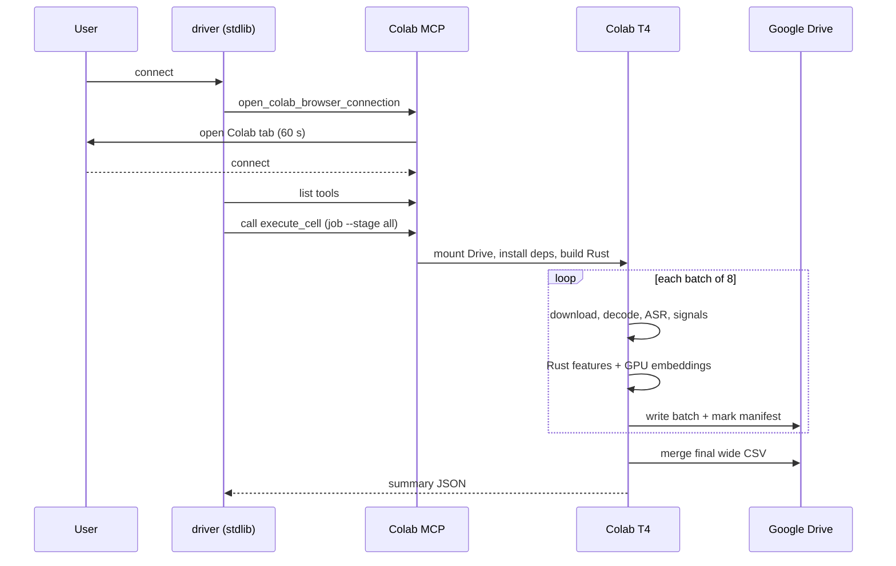

# Colab MCP Run Plan — D-Vlog Binary Depression

H5-OmniFusion redo · branch `redo/rust-ddd` · 2026-11-11.
This plan tells you how to run the full D-Vlog processing on Colab through the
Colab MCP. It uses the same pipeline that the local sample run verifies.

## 1. Purpose

You process 961 YouTube vlogs into a 200-feature vector plus 768-d embeddings.
The target is binary depression only. The MCP drives a Colab notebook. The
preprocessing code stays separate from the training code.

## 2. Glossary

| Term | Meaning |
|---|---|
| MCP | Model Context Protocol. The bridge to a Colab browser session. |
| driver | `rust/bridge/colab_mcp_driver.py`. A stdlib JSON-RPC client. |
| job | `colab/dvlog_job.py`. The Colab-side setup and run wrapper. |
| batch | A group of 8 videos processed and saved together. |
| manifest | A Drive-side JSON record of finished videos. It enables resume. |
| Exact | A feature computed from a real signal. |
| Absent | A feature with no signal. The value is NaN, never zero. |

## 3. Hard rules

WARNING: confirm the YouTube terms of service and the D-Vlog license before the
download stage. The download stage is the only stage that uses the network.

WARNING: the MCP needs a live browser connection. A human must connect the
Colab tab within 60 seconds. The driver cannot connect alone.

CAUTION: do not overwrite old outputs. Each run writes a new dated subfolder.

- Stream every batch to Google Drive as it completes.
- Keep the manifest on Drive. Use atomic writes (temp file, then rename).
- Edit notebooks by append only. Never delete or reorder existing cells.
- Use the T4 GPU for encoders. Use the CPU for download, decode, and Rust.

## 4. Asset tree

```
useless/
├── preprocessing/            Python pipeline (15 files, 1029 LOC)
│   ├── cli.py                sample | dry-run | run modes
│   ├── pipeline.py           batch orchestrator + resume + merge
│   ├── signals.py            synthetic + real signal derivation
│   ├── encoders.py           768-d GPU embeddings (lazy torch)
│   ├── rust_bridge.py        signals-in, features-out subprocess
│   ├── assemble.py           200-wide fill, NaN + Absent
│   ├── media.py / asr.py     yt-dlp + ffmpeg + whisper (lazy)
│   └── tests/                11 stdlib unittest cases
├── rust/                     Rust workspace (19 rs files, 1089 LOC)
│   ├── crates/               13 crates, std-only, 34 tests
│   └── bridge/
│       └── colab_mcp_driver.py   programmatic MCP client (197 LOC)
├── colab/
│   └── dvlog_job.py          Colab setup + run wrapper (101 LOC)
└── dvlog-video-links.csv     961 records (555 depression, 406 normal)
```

## 5. Counts and LOC

| Area | Files | LOC | Largest file |
|---|---|---|---|
| preprocessing (Python) | 15 | 1029 | schema_catalog.py (207) |
| rust crates (Rust) | 19 | 1089 | catalog.rs (238) |
| colab job (Python) | 1 | 101 | dvlog_job.py (101) |
| MCP driver (Python) | 1 | 197 | colab_mcp_driver.py (197) |
| Cargo manifests | 14 | — | — |

Every source file is under 500 lines. The Rust build is green. The Rust tests
pass (34). The Python tests pass (11).

## 6. MCP sequence



## 7. Stage plan

The job has four stages. Run them in order, or use `--stage all`.

| Stage | Action | Runtime |
|---|---|---|
| mount | Mount Google Drive. | CPU |
| deps | pip install yt-dlp, whisper, librosa, cv2, transformers. | CPU |
| build | Install rustup if absent. `cargo build --release`. | CPU |
| run | Download, decode, ASR, signals, Rust features, embeddings. | CPU + GPU |

### 7.1 Driver commands

Step 1. Smoke-test the MCP server.

```
python rust/bridge/colab_mcp_driver.py list
```

Step 2. Connect the browser. A human must approve the Colab tab.

```
python rust/bridge/colab_mcp_driver.py connect
```

Step 3. Discover the notebook tools. The names appear after connect.

```
python rust/bridge/colab_mcp_driver.py list
```

Step 4. Call a notebook tool. Put the arguments in a JSON file.

```
python rust/bridge/colab_mcp_driver.py call <tool> args.json
```

WARNING: the exact notebook tool names come from the Colab frontend. Read them
from step 3. Do not guess names.

### 7.2 Notebook cells (append only)

Append these cells to a new Colab notebook. Set the runtime to T4 GPU.

Cell 1 — get the repo onto Colab (upload or sync the branch to Drive first):

```
!cp -r /content/drive/MyDrive/useless /content/useless
```

Cell 2 — run the full job:

```
!python /content/useless/colab/dvlog_job.py --stage all --repo /content/useless
```

Cell 3 — verify the outputs on Drive:

```
!ls /content/drive/MyDrive/DAIC-WOZ_Datasets/features/D-Vlog/*/
```

## 8. Resume and streaming

The pipeline writes one folder per batch under `features/D-Vlog/<date>/batches`.
It marks each video in `manifest.json` after the batch saves. On restart, the
pipeline skips finished videos. The final merge concatenates all batch folders.
A VM disconnect never loses a finished batch.

## 9. Completeness verdict

| Item | State |
|---|---|
| Preprocessing + feature code | Complete. |
| Local sample verification | Complete. 11 Python + 34 Rust tests pass. |
| Rust build | Complete. Green. |
| MCP driver + job | Complete. Dry-run verified. |
| Full 961-video production run | Not run. Needs Colab + browser + license confirmation. |
| Full 200-feature extraction | Partial. 5 features Exact (one per modality); 195 NaN + Absent. |

The code is complete and sample-verified. The production run is pending. The
200-feature contract holds: absent features are NaN with a reliability flag.

## 10. Provenance

- Schema: `FINAL_200_FEATURE_SCHEMA.md` (200 IDs).
- Asset plan: `RUST_DDD_ASSET_PLAN_ASD-STE100.md`.
- Execution plan: `COLAB_EXECUTION_PLAN_ASD-STE100.md`.
- Counts: `find rust/crates -name '*.rs' | wc -l` → 19;
  `find preprocessing -name '*.py' | wc -l` → 15.
- Tests: `cargo test --workspace` → 34; `python -m unittest discover -s
  preprocessing/tests` → 11.