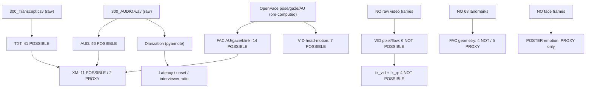

# Feature Feasibility Matrix — H5-OmniFusion

**Document ID:** FEATURE_FEASIBILITY_MATRIX_ASD-STE100
**Timestamp:** 2026-11-11 (UTC). E-DAIC archive inspected on 2026-11-11.
**Status:** Recommendation only. The user makes the decision.
**Scope:** This document states which planned features are possible, and which are
not possible, from each dataset. It cross-references every feature-list document
in the repository. The detailed matrix uses the verified E-DAIC archive `300_P`.

> WARNING: This document does not change code. It does not delete features. It
> recommends only. Wait for the user decision before any change.

---

## 1. Purpose

The user downloaded one E-DAIC participant archive. The user asked two questions:

1. Is the archive correct, or is data missing?
2. Can all the planned feature extraction run on this data?

This document answers both. It gives a per-feature verdict. It lists the raw
input that each feature needs. It names the gaps. It gives recovery options,
including open video datasets. The user then decides.

**Headline result (E-DAIC, 200-feature schema):**

- **168 features are POSSIBLE.** The raw input is present.
- **16 features are PARTIAL.** Only a proxy is possible.
- **16 features are NOT POSSIBLE.** The raw input is absent.

The archive is correct and complete. E-DAIC ships **no raw video** by design.
That single fact causes all 16 blocked features.

---

## 2. Glossary

Define each term before first use. Use one term for one concept.

| Term | Definition |
|------|------------|
| primitive | A hand-designed scalar feature. One signal. Example: `f0_std`. |
| fusion feature | An interaction of two modalities plus a quality gate. ID prefix `fx_`. |
| modality | One input channel: audio, text, video, face, tabular. |
| raw input | The original signal: a WAV file, a transcript, video frames. |
| pre-computed feature | A feature already extracted by the dataset publisher. |
| landmark | One of 68 facial geometry points (x, y). OpenFace can emit them. |
| AU | Action Unit. One facial muscle movement. Example: AU12 = smile. |
| OpenFace | A tool that emits head pose, gaze, and AUs from face frames. |
| NaN flag | A missing value marked `NaN`, with a reliability flag. Never a zero. |
| E-DAIC | Extended-DAIC. The AVEC 2019 dataset. Open access. |
| DAIC-WOZ | The original ISI USC dataset. Access-controlled. Has raw video. |
| EATD | EATD-Corpus. A text-and-audio dataset. No video, no face. |
| proxy | An approximate substitute for a feature. Not the exact definition. |
| POSTER v2 | A facial-expression model. It needs face image frames. |
| VideoMAE | A video model. It needs raw video frames. |
| diarization | Separation of interviewer speech from participant speech. |

---

## 3. Source document register

This matrix refers to all feature-list documents below. The tree shows the
hierarchy. The table gives real line counts and feature content.

### 3.1 Hierarchy tree

```
useless/
├── FINAL_200_FEATURE_SCHEMA.md          ← the extraction target (200 features)
├── DEEP_FEATURE_EXTRACTION_CATALOG.md   ← master catalog (255 candidate rows)
├── FUSION_DERIVED_REPLACEMENTS.md       ← 99 fusion replacements (fx_*)
├── FEATURE_FEASIBILITY_MATRIX_ASD-STE100.md  ← THIS document
├── OPERATIONAL_CODE_AUDIT_ASD-STE100.md ← KEEP/DELETE/FIX audit
├── COLAB_EXECUTION_PLAN_ASD-STE100.md   ← download→extract→train→push plan
├── AGENTS.md                            ← project rules (STE100, append-only)
└── docs/ml_pipeline/
    ├── 108_step_specification.md        ← P1–P40, R1–R59, ADV1–ADV9
    └── ARCHITECTURE.md                  ← H5-OmniFusion model + encoders
```

### 3.2 Document table (real LOC)

| Document | LOC | Feature-list content | Role in this matrix |
|----------|-----|----------------------|---------------------|
| `FINAL_200_FEATURE_SCHEMA.md` | 211 | 156 primitives + 44 fusion = 200 | The verdict target. Each row gets a verdict. |
| `DEEP_FEATURE_EXTRACTION_CATALOG.md` | 584 | 255 candidates; 7 modalities | Defines each feature's formula and raw input. |
| `FUSION_DERIVED_REPLACEMENTS.md` | 140 | 99 `fx_*` interactions | Defines each fusion feature's partner signal. |
| `docs/ml_pipeline/108_step_specification.md` | 241 | 108 steps (P/R/ADV) | Maps features to extraction steps and inputs. |
| `docs/ml_pipeline/ARCHITECTURE.md` | 192 | 5 encoders + fusion + MoE | Shows which encoders need raw video/frames. |
| `OPERATIONAL_CODE_AUDIT_ASD-STE100.md` | 644 | KEEP/DELETE/FIX per module | Context only. Not a feature list. |
| `COLAB_EXECUTION_PLAN_ASD-STE100.md` | 605 | Phase 1–4 plan | Context. §7.3 records the E-DAIC source. |
| `AGENTS.md` | 48 | Rules | Context. Defines the NaN-flag rule. |

### 3.3 Feature-family counts per source document

| Family | Catalog (255) | 200-schema | Fusion replacements (99) |
|--------|---------------|------------|--------------------------|
| AUD (audio) | 97 | 46 | 32 |
| TXT (text) | 68 | 41 | 16 |
| VID (video) | 31 | 15 | 9 |
| FAC (face) | 57 | 23 | 28 |
| TAB (tabular) | 20 | 11 | 7 |
| XM (cross-modal) | 20 | 13 | 4 |
| Q (quality) | 12 | 7 | 3 |

> NOTE: The catalog is larger than the 200-schema. The 200-schema is the curated
> extraction target. This matrix judges the 200-schema. The catalog gives the
> raw-input definition for each feature.

---

## 4. Verified E-DAIC input inventory (`300_P`)

The agent inspected `300_P.tar.gz` on 2026-11-11. The archive is 267 MB
(279,811,302 bytes). `gzip -t` passes. The archive is complete, not truncated.

### 4.1 What is present

| File | Size | Type | Raw or pre-computed |
|------|------|------|---------------------|
| `300_AUDIO.wav` | 20 MB | Raw audio | **Raw.** 16 kHz, mono, 16-bit, 10.8 min. |
| `300_Transcript.csv` | 4 KB | Timed text | **Raw.** Columns: `Start_Time, End_Time, Text, Confidence`. |
| `features/300_CNN_VGG.mat` | 304 MB | Visual embedding | Pre-computed (VGG). |
| `features/300_CNN_ResNet.mat` | 152 MB | Visual embedding | Pre-computed (ResNet). |
| `features/300_densenet201.csv` | 14 MB | Visual embedding | Pre-computed (DenseNet201). |
| `features/300_vgg16.csv` | 16 MB | Visual embedding | Pre-computed (VGG16). |
| `features/300_OpenFace2.1.0_Pose_gaze_AUs.csv` | 6 MB | Face signals | Pre-computed. Pose + gaze + 18 AUs. |
| `features/300_OpenSMILE2.3.0_egemaps.csv` | 16 MB | Audio features | Pre-computed (eGeMAPS). |
| `features/300_OpenSMILE2.3.0_mfcc.csv` | 34 MB | Audio features | Pre-computed (MFCC). |
| `features/300_BoAW_openSMILE_2.3.0_eGeMAPS.csv` | 4 MB | Audio BoAW | Pre-computed. |
| `features/300_BoAW_openSMILE_2.3.0_MFCC.csv` | 4 MB | Audio BoAW | Pre-computed. |
| `features/300_BoVW_openFace_2.1.0_Pose_Gaze_AUs.csv` | 3 MB | Visual BoVW | Pre-computed. |

### 4.2 What is absent (the gaps)

| Absent input | Consequence |
|--------------|-------------|
| **Raw video frames** (no `.mp4`/`.avi`) | No optical flow, no body motion, no scene brightness, no exposure. VideoMAE cannot run. |
| **68 facial landmarks** | OpenFace file has pose/gaze/AUs only. No geometry features. |
| **Face image frames** | POSTER v2 cannot run. No learned face-emotion embedding. |
| **Left/right AU split** | OpenFace gives one intensity per AU. No AU symmetry. |
| **Speaker labels in transcript** | No `Ellie` vs `participant` column. Diarization on raw audio can recover this. |
| **Wall-clock start time** | Transcript time is relative (seconds). No `session_start_hour`. |

> WARNING: The size is correct. E-DAIC distributes pre-computed features instead
> of raw video. A raw-video interview would be multi-GB. The video is not
> compressed away. It is simply not shipped.

### 4.3 OpenFace columns (verified)

The file `300_OpenFace2.1.0_Pose_gaze_AUs.csv` has these column groups:

- `frame, timestamp, confidence, success`
- `pose_Tx, pose_Ty, pose_Tz, pose_Rx, pose_Ry, pose_Rz` (head translation + rotation)
- `gaze_0_x/y/z, gaze_1_x/y/z, gaze_angle_x, gaze_angle_y`
- `AU01_r … AU45_r` (18 AU intensities)
- `AU01_c … AU45_c` (AU presence flags)

There are **no** `x_0…x_67` / `y_0…y_67` landmark columns. This is the verified
cause of the face-geometry gaps.

---

## 5. Raw-input requirement by modality

Each feature family needs a specific raw input. The table maps family → input →
E-DAIC availability.

| Family | Required raw input | E-DAIC supply | Verdict driver |
|--------|--------------------|---------------|----------------|
| AUD | Raw audio waveform | `300_AUDIO.wav` present | All audio features possible. |
| TXT | Transcript text | `300_Transcript.csv` present | All text features possible. |
| VID (head) | Head pose trace | OpenFace pose present | Head-motion features possible. |
| VID (pixel) | Raw video frames | **Absent** | Pixel/flow features blocked. |
| FAC (AU/gaze) | AUs, gaze, pose, blink | OpenFace present | AU/gaze/blink features possible. |
| FAC (geometry) | 68 landmarks | **Absent** | Geometry features blocked or proxy. |
| FAC (emotion) | Face frames + POSTER | **Absent** | Emotion-label features proxy only. |
| TAB | Transcript timing + metadata | Present (relative time) | Most possible; wall-clock blocked. |
| XM | Audio + text + face | Present (face = AU proxy) | Most possible; emotion-match proxy. |
| Q | Audio + transcript + confidence | Present | All quality flags possible. |
| fx_* | Base primitive + partner signal | Depends on both | Blocked only if a partner is blocked. |

### 5.1 Input-to-feasibility diagram



---

## 6. Feasibility summary

### 6.1 Counts by modality (200-schema)

| Family | Total | POSSIBLE | PARTIAL | NOT POSSIBLE |
|--------|-------|----------|---------|--------------|
| AUD | 46 | 46 | 0 | 0 |
| TXT | 41 | 41 | 0 | 0 |
| VID | 15 | 7 | 2 | 6 |
| FAC | 23 | 14 | 5 | 4 |
| TAB | 11 | 6 | 3 | 2 |
| XM | 13 | 11 | 2 | 0 |
| Q | 7 | 7 | 0 | 0 |
| **Primitives** | **156** | **132** | **12** | **12** |
| fx_aud | 13 | 12 | 1 | 0 |
| fx_txt | 8 | 6 | 2 | 0 |
| fx_vid | 4 | 1 | 0 | 3 |
| fx_fac | 13 | 12 | 1 | 0 |
| fx_xm | 4 | 4 | 0 | 0 |
| fx_q | 2 | 1 | 0 | 1 |
| **Fusion** | **44** | **36** | **4** | **4** |
| **TOTAL** | **200** | **168** | **16** | **16** |

### 6.2 ASCII chart

```
POSSIBLE     |██████████████████████████████████████████████████ 168  (84%)
PARTIAL      |█████                                               16  ( 8%)
NOT POSSIBLE |█████                                               16  ( 8%)
             +--------------------------------------------------
             0        50        100       150       200
```

### 6.3 Verdict definitions

- **POSSIBLE:** The raw input is present. Compute the feature as defined. A
  standard step (VAD, F0, diarization, embedding) may run. All such steps are
  available in the Colab environment.
- **PARTIAL:** Only a proxy is possible. The result deviates from the exact
  definition. Emit the proxy with a reliability flag, or emit `NaN`.
- **NOT POSSIBLE:** The required raw input is absent. No faithful proxy exists.
  Emit `NaN` + flag (`Q-008`, `Q-010`). Never emit a silent zero.

---

## 7. Per-feature feasibility matrix (all 200)

The matrix below classifies every feature in `FINAL_200_FEATURE_SCHEMA.md`.
The verdict follows the rules in Section 6.3. The last column names the source
input (POSSIBLE) or the gap (PARTIAL / NOT POSSIBLE).

| # | ID | Name | Modality | Kind | Verdict | Source / gap |
|---|----|------|----------|------|---------|--------------|
| 1 | `AUD-004` | f0_iqr | audio | primitive | POSSIBLE | Raw WAV |
| 2 | `AUD-005` | f0_cv | audio | primitive | POSSIBLE | Raw WAV |
| 3 | `AUD-006` | f0_delta_mean | audio | primitive | POSSIBLE | Raw WAV |
| 4 | `AUD-007` | f0_delta_max | audio | primitive | POSSIBLE | Raw WAV |
| 5 | `AUD-008` | f0_pitch_reset | audio | primitive | POSSIBLE | Raw WAV |
| 6 | `AUD-009` | f0_question_rise | audio | primitive | POSSIBLE | Raw WAV |
| 7 | `AUD-010` | f0_trend_slope | audio | primitive | POSSIBLE | Raw WAV |
| 8 | `AUD-011` | f0_autocorr_period | audio | primitive | POSSIBLE | Raw WAV |
| 9 | `AUD-012` | f0_entropy | audio | primitive | POSSIBLE | Raw WAV |
| 10 | `AUD-013` | f0_skewness | audio | primitive | POSSIBLE | Raw WAV |
| 11 | `AUD-014` | f0_kurtosis | audio | primitive | POSSIBLE | Raw WAV |
| 12 | `AUD-015` | f0_pct_below_person_median | audio | primitive | POSSIBLE | Raw WAV |
| 13 | `AUD-016` | f0_contour_slope_std | audio | primitive | POSSIBLE | Raw WAV |
| 14 | `AUD-017` | f0_syllable_peak_count | audio | primitive | POSSIBLE | Raw WAV |
| 15 | `AUD-023` | loudness_cv | audio | primitive | POSSIBLE | Raw WAV |
| 16 | `AUD-024` | loudness_slope_session | audio | primitive | POSSIBLE | Raw WAV |
| 17 | `AUD-025` | loudness_delta_mean | audio | primitive | POSSIBLE | Raw WAV |
| 18 | `AUD-026` | loudness_peak_freq | audio | primitive | POSSIBLE | Raw WAV |
| 19 | `AUD-027` | whisper_ratio | audio | primitive | POSSIBLE | Raw WAV |
| 20 | `AUD-031` | jitter_local_pct | audio | primitive | POSSIBLE | Raw WAV |
| 21 | `AUD-032` | jitter_rap | audio | primitive | POSSIBLE | Raw WAV |
| 22 | `AUD-034` | shimmer_apq3 | audio | primitive | POSSIBLE | Raw WAV |
| 23 | `AUD-039` | spectral_rolloff_85 | audio | primitive | POSSIBLE | Raw WAV |
| 24 | `AUD-040` | spectral_bandwidth_mean | audio | primitive | POSSIBLE | Raw WAV |
| 25 | `AUD-044` | mfcc1_delta_mean | audio | primitive | POSSIBLE | Raw WAV |
| 26 | `AUD-047` | f1_f2_space_area | audio | primitive | POSSIBLE | Raw WAV |
| 27 | `AUD-049` | vocal_efficiency | audio | primitive | POSSIBLE | Raw WAV |
| 28 | `AUD-050` | roughness | audio | primitive | POSSIBLE | Raw WAV |
| 29 | `AUD-054` | pause_median | audio | primitive | POSSIBLE | Raw WAV |
| 30 | `AUD-055` | pause_std | audio | primitive | POSSIBLE | Raw WAV |
| 31 | `AUD-057` | pause_cv | audio | primitive | POSSIBLE | Raw WAV |
| 32 | `AUD-058` | long_pause_count | audio | primitive | POSSIBLE | Raw WAV |
| 33 | `AUD-059` | verylong_pause_count | audio | primitive | POSSIBLE | Raw WAV |
| 34 | `AUD-060` | pause_log_slope | audio | primitive | POSSIBLE | Raw WAV |
| 35 | `AUD-062` | speaking_rate_std | audio | primitive | POSSIBLE | Raw WAV |
| 36 | `AUD-063` | utterance_len_mean | audio | primitive | POSSIBLE | Raw WAV |
| 37 | `AUD-067` | onset_delay_mean | audio | primitive | POSSIBLE | Raw WAV |
| 38 | `AUD-068` | turn_total_silence | audio | primitive | POSSIBLE | Raw WAV |
| 39 | `AUD-069` | speech_fill_ratio | audio | primitive | POSSIBLE | Raw WAV |
| 40 | `AUD-070` | dysfluency_acoustic | audio | primitive | POSSIBLE | Raw WAV |
| 41 | `AUD-071` | burst_speed | audio | primitive | POSSIBLE | Raw WAV |
| 42 | `AUD-075` | sigh_duration_ratio | audio | primitive | POSSIBLE | Raw WAV |
| 43 | `AUD-077` | swallow_count | audio | primitive | POSSIBLE | Raw WAV |
| 44 | `AUD-078` | laugh_count | audio | primitive | POSSIBLE | Raw WAV |
| 45 | `AUD-082` | latency_median | audio | primitive | POSSIBLE | Raw WAV |
| 46 | `AUD-084` | latency_trend | audio | primitive | POSSIBLE | Raw WAV |
| 47 | `TXT-002` | sentiment_neg_minus_pos | text | primitive | POSSIBLE | Transcript |
| 48 | `TXT-003` | sentiment_var | text | primitive | POSSIBLE | Transcript |
| 49 | `TXT-004` | sentiment_trajectory | text | primitive | POSSIBLE | Transcript |
| 50 | `TXT-006` | emotion_neg_emotion_total | text | primitive | POSSIBLE | Transcript |
| 51 | `TXT-007` | emotion_joy_minus_sadness | text | primitive | POSSIBLE | Transcript |
| 52 | `TXT-008` | dominant_emotion_entropy | text | primitive | POSSIBLE | Transcript |
| 53 | `TXT-009` | anxiety_words_ratio | text | primitive | POSSIBLE | Transcript |
| 54 | `TXT-010` | sadness_words_ratio | text | primitive | POSSIBLE | Transcript |
| 55 | `TXT-011` | death_suicide_markers | text | primitive | POSSIBLE | Transcript |
| 56 | `TXT-014` | first_person_plural_ratio | text | primitive | POSSIBLE | Transcript |
| 57 | `TXT-015` | second_person_ratio | text | primitive | POSSIBLE | Transcript |
| 58 | `TXT-016` | third_person_ratio | text | primitive | POSSIBLE | Transcript |
| 59 | `TXT-017` | i_you_ratio | text | primitive | POSSIBLE | Transcript |
| 60 | `TXT-018` | impersonal_pronoun_ratio | text | primitive | POSSIBLE | Transcript |
| 61 | `TXT-023` | cognitive_mechanism | text | primitive | POSSIBLE | Transcript |
| 62 | `TXT-024` | tentatives_ratio | text | primitive | POSSIBLE | Transcript |
| 63 | `TXT-025` | exclusions_ratio | text | primitive | POSSIBLE | Transcript |
| 64 | `TXT-026` | negations_ratio | text | primitive | POSSIBLE | Transcript |
| 65 | `TXT-027` | rumination_markers | text | primitive | POSSIBLE | Transcript |
| 66 | `TXT-028` | self_blame_ratio | text | primitive | POSSIBLE | Transcript |
| 67 | `TXT-029` | temporal_orientation_ratio | text | primitive | POSSIBLE | Transcript |
| 68 | `TXT-033` | unique_words / rare_words_ratio | text | primitive | POSSIBLE | Transcript |
| 69 | `TXT-036` | flesch_reading_ease trend | text | primitive | POSSIBLE | Transcript |
| 70 | `TXT-037` | lexical_hard_words_ratio | text | primitive | POSSIBLE | Transcript |
| 71 | `TXT-038` | noun_verb_ratio | text | primitive | POSSIBLE | Transcript |
| 72 | `TXT-039` | adverb_adjective_ratio | text | primitive | POSSIBLE | Transcript |
| 73 | `TXT-040` | content_word_ratio | text | primitive | POSSIBLE | Transcript |
| 74 | `TXT-042` | topic_shift_rate | text | primitive | POSSIBLE | Transcript |
| 75 | `TXT-043` | semantic_coherence | text | primitive | POSSIBLE | Transcript |
| 76 | `TXT-044` | repetition_ngram_ratio | text | primitive | POSSIBLE | Transcript |
| 77 | `TXT-045` | topical_concentration | text | primitive | POSSIBLE | Transcript |
| 78 | `TXT-046` | self_story_length | text | primitive | POSSIBLE | Transcript |
| 79 | `TXT-047` | social_topic_ratio | text | primitive | POSSIBLE | Transcript |
| 80 | `TXT-048` | work_activity_ratio | text | primitive | POSSIBLE | Transcript |
| 81 | `TXT-050` | appetite_weight_words | text | primitive | POSSIBLE | Transcript |
| 82 | `TXT-051` | energy_words_ratio | text | primitive | POSSIBLE | Transcript |
| 83 | `TXT-052` | concentration_markers | text | primitive | POSSIBLE | Transcript |
| 84 | `TXT-053` | hopelessness_ratio | text | primitive | POSSIBLE | Transcript |
| 85 | `TXT-054` | filler_count_ratio | text | primitive | POSSIBLE | Transcript |
| 86 | `TXT-060` | min_turn_len_ratio | text | primitive | POSSIBLE | Transcript |
| 87 | `TXT-061` | monosyllabic_answer_rate | text | primitive | POSSIBLE | Transcript |
| 88 | `VID-005` | stillness_ratio | video | primitive | NOT POSSIBLE | No raw video frames (frame motion) |
| 89 | `VID-006` | motion_entropy | video | primitive | NOT POSSIBLE | No raw video frames (optical flow) |
| 90 | `VID-008` | head_yaw_std, head_pitch_std | video | primitive | POSSIBLE | OpenFace pose |
| 91 | `VID-009` | head_nod_rate | video | primitive | POSSIBLE | OpenFace pose |
| 92 | `VID-010` | head_shake_rate | video | primitive | POSSIBLE | OpenFace pose |
| 93 | `VID-013` | head_stillness_ratio | video | primitive | POSSIBLE | OpenFace pose |
| 94 | `VID-014` | body_motion_bands | video | primitive | NOT POSSIBLE | No raw video frames (body motion) |
| 95 | `VID-015` | face_region_motion | video | primitive | NOT POSSIBLE | No raw video frames (face-box motion) |
| 96 | `VID-016` | posture_drift | video | primitive | POSSIBLE | OpenFace pose |
| 97 | `VID-017` | blink_motion_coupling | video | primitive | POSSIBLE | OpenFace pose |
| 98 | `VID-018` | scene_brightness_mean/std | video | primitive | NOT POSSIBLE | No raw video pixels (brightness) |
| 99 | `VID-021` | overexposed_ratio | video | primitive | NOT POSSIBLE | No raw video pixels (exposure) |
| 100 | `VID-022` | motion_sync_with_speech | video | primitive | POSSIBLE | OpenFace pose |
| 101 | `VID-023` | activity_onset_count | video | primitive | PARTIAL | Head-motion proxy; body fidgets need video |
| 102 | `VID-024` | periodic_motion_peak | video | primitive | PARTIAL | Head-motion proxy; body motion needs video |
| 103 | `FAC-016` | Duchenne_ratio | face | primitive | POSSIBLE | OpenFace AU/gaze/pose |
| 104 | `FAC-017` | au_variability_mean | face | primitive | POSSIBLE | OpenFace AU/gaze/pose |
| 105 | `FAC-018` | au_active_ratio | face | primitive | POSSIBLE | OpenFace AU/gaze/pose |
| 106 | `FAC-019` | au_range_mean | face | primitive | POSSIBLE | OpenFace AU/gaze/pose |
| 107 | `FAC-020` | au_symmetry | face | primitive | NOT POSSIBLE | No left/right AU split |
| 108 | `FAC-023` | au_entropy | face | primitive | POSSIBLE | OpenFace AU/gaze/pose |
| 109 | `FAC-027` | neutral_face_ratio | face | primitive | PARTIAL | AU proxy; no POSTER emotion labels |
| 110 | `FAC-029` | expression_change_rate | face | primitive | PARTIAL | AU proxy; no emotion labels |
| 111 | `FAC-036` | gaze_down_ratio | face | primitive | POSSIBLE | OpenFace AU/gaze/pose |
| 112 | `FAC-037` | gaze_saccade_rate | face | primitive | POSSIBLE | OpenFace AU/gaze/pose |
| 113 | `FAC-038` | eye_contact_stability | face | primitive | POSSIBLE | OpenFace AU/gaze/pose |
| 114 | `FAC-039` | gaze_aversion_onset | face | primitive | POSSIBLE | OpenFace AU/gaze/pose |
| 115 | `FAC-043` | blink_std | face | primitive | POSSIBLE | OpenFace AU/gaze/pose |
| 116 | `FAC-044` | long_blink_ratio | face | primitive | POSSIBLE | OpenFace AU/gaze/pose |
| 117 | `FAC-045` | blink_rate_trend | face | primitive | POSSIBLE | OpenFace AU/gaze/pose |
| 118 | `FAC-048` | head_width_ratio / face_size | face | primitive | NOT POSSIBLE | No 68 landmarks; no frames |
| 119 | `FAC-049` | eye_aperture_mean | face | primitive | PARTIAL | AU05/07/45 proxy; no landmark eyelid |
| 120 | `FAC-050` | mouth_openness_mean | face | primitive | PARTIAL | AU25/26 proxy; no landmark mouth |
| 121 | `FAC-051` | brow_corner_drop | face | primitive | PARTIAL | AU01/02/04 proxy; no landmark brow |
| 122 | `FAC-052` | face_symmetry_score | face | primitive | NOT POSSIBLE | No 68 landmarks (symmetry) |
| 123 | `FAC-053` | skin_tone_variance | face | primitive | NOT POSSIBLE | No raw video pixels (skin tone) |
| 124 | `FAC-054` | face_present_ratio | face | primitive | POSSIBLE | OpenFace AU/gaze/pose |
| 125 | `FAC-055` | gaze_shift_to_head_coupling | face | primitive | POSSIBLE | OpenFace AU/gaze/pose |
| 126 | `TAB-001` | interview_duration | tabular | primitive | POSSIBLE | Transcript + WAV (+diarization) |
| 127 | `TAB-002` | total_participant_time | tabular | primitive | POSSIBLE | Transcript + WAV (+diarization) |
| 128 | `TAB-003` | interviewer_participant_ratio | tabular | primitive | POSSIBLE | Transcript + WAV (+diarization) |
| 129 | `TAB-004` | num_questions_answered | tabular | primitive | PARTIAL | Ellie prompts not labeled; needs diarization |
| 130 | `TAB-005` | unanswered_question_count | tabular | primitive | PARTIAL | Ellie prompts not labeled; needs diarization |
| 131 | `TAB-006` | avg_answer_length_words | tabular | primitive | POSSIBLE | Transcript + WAV (+diarization) |
| 132 | `TAB-007` | avg_answer_length_sec | tabular | primitive | POSSIBLE | Transcript + WAV (+diarization) |
| 133 | `TAB-014` | session_start_hour | tabular | primitive | NOT POSSIBLE | Relative time only; no wall-clock |
| 134 | `TAB-015` | audio_sr_detected | tabular | primitive | POSSIBLE | Transcript + WAV (+diarization) |
| 135 | `TAB-016` | gender (from audio/text if provided) | tabular | primitive | PARTIAL | Only if metadata_mapped.csv provides gender |
| 136 | `TAB-017` | age_estimate_face | tabular | primitive | NOT POSSIBLE | No landmarks/face model for age |
| 137 | `XM-003` | incongruence_smile_sadness | cross-modal | primitive | POSSIBLE | Audio + text + AU |
| 138 | `XM-004` | flat_voice_sad_words | cross-modal | primitive | POSSIBLE | Audio + text + AU |
| 139 | `XM-006` | text_face_match | cross-modal | primitive | PARTIAL | Face emotion via AU proxy; no POSTER |
| 140 | `XM-007` | latency_vs_answer_length | cross-modal | primitive | POSSIBLE | Audio + text + AU |
| 141 | `XM-008` | gaze_vs_negative_topic | cross-modal | primitive | POSSIBLE | Audio + text + AU |
| 142 | `XM-009` | pitch_drop_at_negative | cross-modal | primitive | POSSIBLE | Audio + text + AU |
| 143 | `XM-010` | energy_drop_on_self_ref | cross-modal | primitive | POSSIBLE | Audio + text + AU |
| 144 | `XM-011` | pause_on_hard_questions | cross-modal | primitive | POSSIBLE | Audio + text + AU |
| 145 | `XM-012` | smile_rate_per_min | cross-modal | primitive | POSSIBLE | Audio + text + AU |
| 146 | `XM-013` | response_verbosity_trend | cross-modal | primitive | POSSIBLE | Audio + text + AU |
| 147 | `XM-014` | prosody_entropy | cross-modal | primitive | POSSIBLE | Audio + text + AU |
| 148 | `XM-016` | affect_variance | cross-modal | primitive | PARTIAL | Fused emotion trace partly AU proxy |
| 149 | `XM-017` | neg_in_pos_ratio | cross-modal | primitive | POSSIBLE | Audio + text + AU |
| 150 | `Q-001` | modality_present | quality | primitive | POSSIBLE | Audio + transcript + OpenFace |
| 151 | `Q-004` | audio_dur_valid | quality | primitive | POSSIBLE | Audio + transcript + OpenFace |
| 152 | `Q-005` | face_det_coverage | quality | primitive | POSSIBLE | Audio + transcript + OpenFace |
| 153 | `Q-007` | transcript_align_ratio | quality | primitive | POSSIBLE | Audio + transcript + OpenFace |
| 154 | `Q-008` | feature_nan_flag | quality | primitive | POSSIBLE | Audio + transcript + OpenFace |
| 155 | `Q-009` | feature_constant_flag | quality | primitive | POSSIBLE | Audio + transcript + OpenFace |
| 156 | `Q-010` | modality_imputed | quality | primitive | POSSIBLE | Audio + transcript + OpenFace |
| 157 | `fx_aud_080` | latency_mean (interaction) | audio | fusion | POSSIBLE | Base + partner present |
| 158 | `fx_aud_083` | slow_response_ratio (interaction) | audio | fusion | POSSIBLE | Base + partner present |
| 159 | `fx_aud_052` | pause_ratio (interaction) | audio | fusion | POSSIBLE | Base + partner present |
| 160 | `fx_aud_053` | pause_mean / pause_count (interaction) | audio | fusion | POSSIBLE | Base + partner present |
| 161 | `fx_aud_056` | pause_max (interaction) | audio | fusion | POSSIBLE | Base + partner present |
| 162 | `fx_aud_073` | breath_count (interaction) | audio | fusion | POSSIBLE | Base + partner present |
| 163 | `fx_aud_076` | sigh_count, sigh_rate_per_min (interaction) | audio | fusion | POSSIBLE | Base + partner present |
| 164 | `fx_aud_030` | jitter (interaction) | audio | fusion | POSSIBLE | Base + partner present |
| 165 | `fx_aud_033` | shimmer (interaction) | audio | fusion | POSSIBLE | Base + partner present |
| 166 | `fx_aud_020` | loudness_mean (interaction) | audio | fusion | POSSIBLE | Base + partner present |
| 167 | `fx_aud_061` | speaking_rate (interaction) | audio | fusion | POSSIBLE | Base + partner present |
| 168 | `fx_aud_064` | articulation_rate (interaction) | audio | fusion | PARTIAL | Partner mouth_aperture is landmark-proxy |
| 169 | `fx_aud_018` | semitone_mean (interaction) | audio | fusion | POSSIBLE | Base + partner present |
| 170 | `fx_txt_001` | sentiment_compound/neg/pos (interaction) | text | fusion | PARTIAL | Partner emo_agreement needs emotion labels |
| 171 | `fx_txt_005` | emotion_sadness/anger/fear/joy (interaction) | text | fusion | PARTIAL | Partner emo_agreement needs emotion labels |
| 172 | `fx_txt_013` | first_person_ratio (interaction) | text | fusion | POSSIBLE | Base + partner present |
| 173 | `fx_txt_020` | absolutist_ratio (interaction) | text | fusion | POSSIBLE | Base + partner present |
| 174 | `fx_txt_032` | lexical_diversity (interaction) | text | fusion | POSSIBLE | Base + partner present |
| 175 | `fx_txt_056` | talk_ratio (interaction) | text | fusion | POSSIBLE | Base + partner present |
| 176 | `fx_txt_062` | engagement_slope (interaction) | text | fusion | POSSIBLE | Base + partner present |
| 177 | `fx_txt_035` | automated_readability (interaction) | text | fusion | POSSIBLE | Base + partner present |
| 178 | `fx_vid_001` | flow_mean (interaction) | video | fusion | NOT POSSIBLE | Base flow_mean needs raw video |
| 179 | `fx_vid_003` | motion_score (interaction) | video | fusion | NOT POSSIBLE | Base motion_score needs raw video |
| 180 | `fx_vid_011` | head_movement_velocity (interaction) | video | fusion | POSSIBLE | Base + partner present |
| 181 | `fx_vid_019` | frame_quality_ratio, blur_score, brightness (interaction) | video | fusion | NOT POSSIBLE | Base frame_quality needs raw video |
| 182 | `fx_fac_004` | AU4_mean (interaction) | face | fusion | POSSIBLE | Base + partner present |
| 183 | `fx_fac_006` | AU12_mean (interaction) | face | fusion | POSSIBLE | Base + partner present |
| 184 | `fx_fac_008` | AU15_mean (interaction) | face | fusion | POSSIBLE | Base + partner present |
| 185 | `fx_fac_013` | au_sadness_composite (interaction) | face | fusion | POSSIBLE | Base + partner present |
| 186 | `fx_fac_014` | au_happiness_composite (interaction) | face | fusion | POSSIBLE | Base + partner present |
| 187 | `fx_fac_015` | au_depression_indicator (interaction) | face | fusion | POSSIBLE | Base + partner present |
| 188 | `fx_fac_021` | au_smile_timing (interaction) | face | fusion | POSSIBLE | Base + partner present |
| 189 | `fx_fac_022` | au_smile_decay (interaction) | face | fusion | POSSIBLE | Base + partner present |
| 190 | `fx_fac_028` | micro_expression_rate (interaction) | face | fusion | POSSIBLE | Base + partner present |
| 191 | `fx_fac_032` | gaze_direct_ratio (interaction) | face | fusion | POSSIBLE | Base + partner present |
| 192 | `fx_fac_033` | gaze_averted_ratio (interaction) | face | fusion | POSSIBLE | Base + partner present |
| 193 | `fx_fac_041` | blink_rate / blink_rate_per_min (interaction) | face | fusion | POSSIBLE | Base + partner present |
| 194 | `fx_fac_025` | expression_variability (interaction) | face | fusion | PARTIAL | Base expression_variability needs POSTER |
| 195 | `fx_xm_001` | congruence_audio_text_match (interaction) | cross-modal | fusion | POSSIBLE | Base + partner present |
| 196 | `fx_xm_002` | congruence_masking_detected (interaction) | cross-modal | fusion | POSSIBLE | Base + partner present |
| 197 | `fx_xm_005` | audio_face_match (interaction) | cross-modal | fusion | POSSIBLE | Base + partner present |
| 198 | `fx_xm_015` | crossmodal_sync (interaction) | cross-modal | fusion | POSSIBLE | Base + partner present |
| 199 | `fx_q_002` | snr_db ** (interaction) | quality | fusion | POSSIBLE | Base + partner present |
| 200 | `fx_q_006` | frame_quality_ratio ** (interaction) | quality | fusion | NOT POSSIBLE | Base frame_quality needs raw video |

---

## 8. The 16 NOT-POSSIBLE features

These features cannot be computed from E-DAIC. The required raw input is absent.
Group them by the missing input.

### 8.1 Missing raw video frames (10 features)

| ID | Name | Missing input | Recovery |
|----|------|---------------|----------|
| VID-005 | stillness_ratio | Frame motion | Raw video |
| VID-006 | motion_entropy | Optical flow | Raw video |
| VID-014 | body_motion_bands | Frame-region motion | Raw video |
| VID-015 | face_region_motion | Face-box motion | Raw video |
| VID-018 | scene_brightness_mean/std | Pixel gray levels | Raw video |
| VID-021 | overexposed_ratio | Pixel exposure | Raw video |
| fx_vid_001 | flow_mean (interaction) | Base flow needs video | Raw video |
| fx_vid_003 | motion_score (interaction) | Base motion needs video | Raw video |
| fx_vid_019 | frame_quality (interaction) | Base blur/brightness needs video | Raw video |
| fx_q_006 | frame_quality_ratio (interaction) | Base frame quality needs video | Raw video |

### 8.2 Missing 68 landmarks (3 features)

| ID | Name | Missing input | Recovery |
|----|------|---------------|----------|
| FAC-048 | head_width_ratio / face_size | Landmark face box | Re-run OpenFace with landmarks on raw video |
| FAC-052 | face_symmetry_score | Landmark left-right | Re-run OpenFace with landmarks on raw video |
| TAB-017 | age_estimate_face | Landmark face model | Raw video + age model |

### 8.3 Other absent inputs (3 features)

| ID | Name | Missing input | Recovery |
|----|------|---------------|----------|
| FAC-020 | au_symmetry | Left/right AU split | OpenFace does not emit this; needs a different AU tool |
| FAC-053 | skin_tone_variance | Raw face pixels | Raw video |
| TAB-014 | session_start_hour | Wall-clock time | Not recoverable from E-DAIC; metadata only |

> NOTE: 13 of the 16 blocked features need raw video. 2 need landmarks (which
> also need raw video to re-extract). 1 needs wall-clock metadata. Raw video is
> the single highest-value recovery.

---

## 9. The 16 PARTIAL features

These features have a proxy only. The proxy deviates from the exact definition.
The user decides: emit the proxy with a flag, or emit `NaN`.

| ID | Name | Proxy available | Exact input missing |
|----|------|-----------------|---------------------|
| VID-023 | activity_onset_count | Head-motion bursts | Body fidgets (video) |
| VID-024 | periodic_motion_peak | Head-motion spectrum | Body motion (video) |
| FAC-027 | neutral_face_ratio | AU-pattern heuristic | POSTER emotion labels |
| FAC-029 | expression_change_rate | AU-transition rate | Emotion labels |
| FAC-049 | eye_aperture_mean | AU05/AU07/AU45 | Landmark eyelid distance |
| FAC-050 | mouth_openness_mean | AU25/AU26 | Landmark mouth distance |
| FAC-051 | brow_corner_drop | AU01/AU02/AU04 | Landmark brow geometry |
| TAB-004 | num_questions_answered | Diarization + question script | Labeled Ellie prompts |
| TAB-005 | unanswered_question_count | Diarization | Labeled Ellie prompts |
| TAB-016 | gender | `metadata_mapped.csv` if present | Reliable audio/text estimate |
| XM-006 | text_face_match | AU-emotion proxy | POSTER face emotion |
| XM-016 | affect_variance | AU-emotion trace | Fused emotion trace |
| fx_aud_064 | articulation_rate (interaction) | Partner mouth_aperture is proxy | Landmark mouth aperture |
| fx_txt_001 | sentiment (interaction) | Partner emo_agreement is proxy | Face emotion labels |
| fx_txt_005 | emotion (interaction) | Partner emo_agreement is proxy | Face emotion labels |
| fx_fac_025 | expression_variability (interaction) | AU-vector std | POSTER emotion vector |

> NOTE: The 5 face-geometry proxies (FAC-049/050/051) and the 3 emotion proxies
> (FAC-027/029, XM-006) all become exact if raw video is available. Raw video
> upgrades 13 of the 16 partial features to possible.

---

## 10. Architecture impact

The model in `ARCHITECTURE.md` expects raw inputs at Stage 1. E-DAIC changes two
encoder branches. The other three branches run as designed.

| Encoder | Backbone | Needs | E-DAIC status |
|---------|----------|-------|---------------|
| Audio | Wav2Vec2-XLSR + eGeMAPS | Raw WAV | **Runs.** WAV present. |
| Text | MentalRoBERTa | Transcript | **Runs.** Transcript present. |
| Tabular | FT-Transformer | Scalar features | **Runs.** 168 features feed it. |
| Video | VideoMAE-base | Raw video frames | **Cannot run.** No frames. Substitute the provided CNN embeddings. |
| Face | OpenFace + POSTER v2 | Face frames | **Partial.** OpenFace AUs present. POSTER cannot run (no frames). |

> NOTE: The visual modality is not lost. E-DAIC provides VGG/ResNet/DenseNet
> embeddings. These substitute for the VideoMAE output as the visual signal.
> This is a backbone substitution, not the exact architecture. The MoE gate
> (`ARCHITECTURE.md` Stage 4) already down-weights a weak modality. The model
> still receives audio + text + visual + face(AU) + tabular.

---

## 11. Open-dataset recovery option (YouTube and similar)

The user proposed open video datasets, for example from YouTube, to enable the
full feature set. This is viable for the extraction pipeline, with limits.

### 11.1 What open video can do

- Supply raw video frames. This unlocks all 13 video/landmark-blocked features.
- Let VideoMAE and POSTER v2 run as designed.
- Let OpenFace re-extract 68 landmarks (geometry features become exact).
- Validate the full 200-feature extractor end to end on real video.
- Pretrain or fine-tune the visual encoders (self-supervised).

### 11.2 What open video cannot do

> WARNING: A generic YouTube video is not a clinical interview. It has no label
> and no Ellie question structure. It cannot replace DAIC/E-DAIC as supervised
> depression-training data. D-Vlog is different: it has binary labels (Section
> 11.5), but still no PHQ-8 score and no interviewer.

- No PHQ-8 ground truth → no PHQ-8 regression target. D-Vlog gives a binary
  label only, not a 0–24 score.
- No interviewer turns → latency/question features (TAB-004/005, AUD-080) have
  no meaning. A vlog is a monologue.
- Domain shift → vlog video differs from a seated clinical interview.
- Self-reported labels → D-Vlog labels come from the vlogger, not a clinician.

### 11.3 Candidate open sources (confirm access; do not invent URLs)

| Source | What it gives | Label | Use |
|--------|---------------|-------|-----|
| D-Vlog (YouTube depression vlogs) | Raw video + audio | **Binary depression/normal (verified 555/406)** | RECEIVED. Binary auxiliary + full extractor. See Section 11.5. |
| AVEC 2013/2014 (YouTube) | Audio-visual clips | Depression labels | Verify access; older domain. |
| Generic YouTube (CC-licensed) | Raw video | None | Extractor validation + encoder pretraining only. |
| DAIC-WOZ (ISI form) | Raw video + audio + transcript | PHQ-8 | The correct clinical source. Access-controlled. |

> WARNING: Do not invent dataset URLs. Confirm the link, the license, and the
> access terms before download. D-Vlog and AVEC are real published datasets, but
> their download terms must be verified by the user.

### 11.4 Recommended use of open video

Use open video for **extractor validation and encoder pretraining**. D-Vlog can
also serve as a **labeled binary auxiliary set** (depression vs normal). Keep
DAIC-WOZ / E-DAIC as the clinical PHQ-8 source. This gives the full 200-feature
capability without faking clinical labels.

### 11.5 D-Vlog received (verified 2026-11-11)

The user provided `dvlog-video-links.csv`. The agent inspected it. It is the
D-Vlog metadata file. It is a link list, not the video itself.

| Property | Value |
|----------|-------|
| File | `dvlog-video-links.csv` (57,955 bytes) |
| Videos | 961 |
| Columns | `video_id, label, key, gender, duration, channelId` |
| Label | `depression` = 555, `normal` = 406 (binary) |
| Gender | `f` = 639, `m` = 322 |
| Duration | min 23.6 s, max 3968.6 s, mean 596.3 s, median 472.9 s |
| Total video | 159.2 hours |
| Unique channels | 816 |
| `key` | The YouTube video ID (11 characters). |

Label by gender:

| Label | f | m | Total |
|-------|---|---|-------|
| depression | 373 | 182 | 555 |
| normal | 266 | 140 | 406 |

> NOTE: The `key` column is a YouTube video ID. The canonical watch URL is
> `https://www.youtube.com/watch?v=<key>`. This is the standard YouTube URL form,
> not an invented link. The video must be downloaded with a tool such as `yt-dlp`.

> WARNING: The CSV is only metadata. The raw video is not present. Downloading
> 961 videos (159.2 hours) is a large action. Some videos may be removed, private,
> or region-blocked. Respect YouTube terms of service and the D-Vlog license.
> Confirm the download plan with the user before any bulk download.

**What D-Vlog adds to the project:**

- Raw video → unlocks the 13 video/landmark-blocked features (full 200 extractor).
- A binary depression label → an auxiliary task for the binary head.
- Gender + duration → tabular metadata.

**What D-Vlog does not add:**

- No PHQ-8 score → cannot train the PHQ-8 regression head.
- No transcript → needs ASR (for example Whisper) for text features.
- No interviewer → turn/latency features are not meaningful.

---

## 12. Recovery options matrix

Each gap maps to a recovery action. The user picks the combination.

| Gap | Blocked features | Recovery action | Effort | Label-safe |
|-----|------------------|-----------------|--------|------------|
| No raw video | 13 | Get DAIC-WOZ raw video (ISI form) | Access form | Yes |
| No raw video | 13 | Add D-Vlog (received): raw video + binary labels | Download + verify | Yes (binary aux; no PHQ-8) |
| No landmarks | 2 (+5 proxy) | Re-run OpenFace with landmarks on raw video | GPU/CPU compute | Yes |
| No face frames | POSTER + 3 proxy | Run POSTER on raw video frames | GPU compute | Yes |
| No left/right AU | FAC-020 | Use a different AU tool, or drop the feature | Tool swap | Yes |
| No wall-clock | TAB-014 | Read metadata if present; else NaN | Trivial | Yes |
| No speaker labels | TAB-003/004/005 | Run pyannote diarization on raw WAV | CPU/GPU | Yes |
| Accept the gap | 16 | Emit NaN + reliability flag (schema rule) | None | Yes |

---

## 13. Decision for the user

The user makes the decision. This document recommends only. Three options:

### Option A — Use E-DAIC as designed (recommended for speed)

- Compute the 168 POSSIBLE features.
- Emit the 16 PARTIAL as proxies with a flag, or as `NaN`.
- Emit the 16 NOT-POSSIBLE as `NaN` + flag.
- Use the provided CNN embeddings as the visual signal.
- Result: a working multimodal model now. 84% of features exact.

### Option B — Recover the full 200 with clinical raw video

- Obtain DAIC-WOZ raw video (ISI access form).
- Re-run OpenFace (landmarks), VideoMAE, POSTER on the raw video.
- Result: all 200 features exact on DAIC-WOZ. E-DAIC stays at 168.
- Cost: access approval + GPU extraction time.

### Option C — Add D-Vlog for capability + binary auxiliary (hybrid)

- Keep E-DAIC/DAIC-WOZ as the clinical PHQ-8 source.
- Add D-Vlog (received: 961 videos, 555 depression / 406 normal).
- Use D-Vlog raw video to validate the full 200-feature extractor and pretrain
  the visual encoders.
- Optionally use the D-Vlog binary label as an auxiliary task for the binary head.
- Result: the full extractor is proven on real video; clinical PHQ-8 labels stay real.
- Cost: download (159.2 h) + license verification + ASR for text + pretrain compute.

> WARNING: Do not use generic YouTube video as labeled depression-training data.
> It has no ground truth. D-Vlog has a binary label, but no PHQ-8 score. Use D-Vlog
> for the binary task and extraction; keep PHQ-8 regression on DAIC-WOZ/E-DAIC.

---

## 14. Provenance and verification

### 14.1 Evidence

| Claim | Evidence | Date |
|-------|----------|------|
| Archive complete | `gzip -t 300_P.tar.gz` passes | 2026-11-11 |
| Archive size | 279,811,302 bytes (267 MB) | 2026-11-11 |
| Audio valid | WAV header: 16 kHz, mono, 16-bit, 648.5 s | 2026-11-11 |
| No raw video | `tar -tzvf` lists no `.mp4`/`.avi` | 2026-11-11 |
| No landmarks | OpenFace header has pose/gaze/AU only | 2026-11-11 |
| No speaker labels | Transcript header: `Start_Time, End_Time, Text, Confidence` | 2026-11-11 |

### 14.2 Cross-dataset note (expected, not yet verified)

| Dataset | Raw video | Landmarks | Expected verdict |
|---------|-----------|-----------|------------------|
| E-DAIC | No | No | 168 / 16 / 16 (verified from `300_P`) |
| DAIC-WOZ | Yes (full release) | Re-extractable | Near 200 possible (verify on receipt) |
| EATD | No | No | Audio + text only; video/face all NaN (verify on receipt) |

> NOTE: Only E-DAIC is verified. The DAIC-WOZ and EATD rows are expectations.
> Verify each on receipt. Do not assume.

### 14.3 Verification checklist

- [x] All 200 features classified (168 + 16 + 16 = 200).
- [x] Every source document referenced with real LOC.
- [x] At least one diagram (mermaid) and one chart (ASCII).
- [x] Hierarchical tree present.
- [x] Timestamp present.
- [x] Recovery options include open video (YouTube/D-Vlog) with label warning.
- [ ] User decision recorded (Option A / B / C).

---

*End of matrix. This document recommends only. The user makes the decision.
Await the user choice before any code or schema change.*