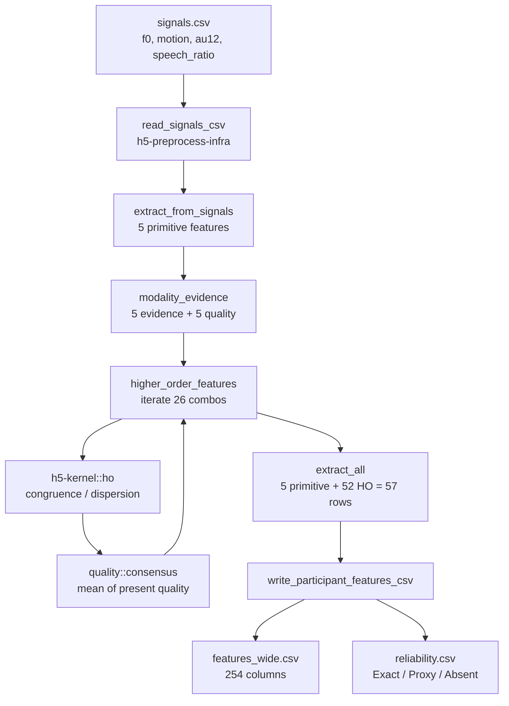

# Higher-Order Cross-Modal Features — Plan and Record

Date: 2026-11-11. Branch: `redo/rust-ddd`. Status: implemented and verified.
This document records the design, the code, and the local verification.
It follows ASD-STE100 Issue 9. Read the glossary before the first use of a term.

## 1. Purpose

The base schema holds 200 features. The base fusion rows join only two
modalities. Depression can hide in one channel and show in another.
A two-way join can miss this pattern. This extension adds higher-order
features. Each feature joins 2, 3, 4, or 5 modalities. The new total is 252.

- The extension finds convergence: many channels agree on depression.
- The extension finds masking: one channel hides what others show.
- The extension keeps the absent contract: NaN plus a reliability flag.

## 2. Glossary

| Term | Definition |
|---|---|
| modality | One input channel: audio, text, video, face, or tabular. |
| evidence | A per-modality depression proxy. The range is 0 to 1. |
| quality | A reliability weight: Exact = 1.0, Proxy = 0.6, Absent = NaN. |
| consensus | The mean of the present quality scores. NaN when none present. |
| congruence | The geometric mean of evidence, times consensus. The `-C` feature. |
| dispersion | The population standard deviation of evidence, times consensus. The `-D` feature. |
| combination | A subset of modalities of size k. The order is canonical. |
| higher-order (HO) | A feature across two or more modalities. |
| reliability flag | One of Exact, Proxy, or Absent. |
| primitive | A direct hand-computed feature. The count is 156. |
| fusion | A derived interaction feature. The count is now 96. |

## 3. Design

### 3.1 Canonical modality order

The code uses a fixed order. The index maps to one letter and one channel.

| Index | Letter | Modality |
|---|---|---|
| 0 | A | audio |
| 1 | T | text |
| 2 | V | video |
| 3 | F | face |
| 4 | B | tabular |

### 3.2 Per-modality evidence

Each modality gives one depression proxy. The code clamps each proxy to
the range 0 to 1. A high value means more depression evidence.

| Modality | Source feature | Evidence formula |
|---|---|---|
| audio (A) | AUD-005 (f0 CV) | `1 / (1 + f0_cv)` |
| text (T) | TXT-033 (lexical diversity) | `1 - diversity` |
| video (V) | VID-005 (stillness) | `stillness` |
| face (F) | FAC-018 (AU active) | `1 - au_active` |
| tabular (B) | speech_ratio signal | `1 - speech_ratio` |

### 3.3 The two feature forms

For each combination of size k, the code emits two features.

- Congruence `-C` = `(product of evidence)^(1/k) * consensus(quality)`.
  A high value means the channels agree on depression.
- Dispersion `-D` = `std_dev(evidence) * consensus(quality)`.
  A high value means the channels disagree. This captures masking.

The consensus gate downweights weak channels. A Proxy channel weighs 0.6.
An Exact channel weighs 1.0. The gate never acts as a silent zero.

### 3.4 Reliability rule

WARNING: A missing modality must emit NaN plus Absent. Never emit a zero.

- The feature is Absent when any required modality is absent.
- The feature is Proxy when the code computes it from proxies.
- The code never labels an HO feature Exact. The inputs are proxies.

### 3.5 Combination counts

The count of combinations is `C(5, k)`. Each combination gives two features.

| k (ways) | Combinations `C(5,k)` | Features (×2) |
|---|---|---|
| 2 | 10 | 20 |
| 3 | 10 | 20 |
| 4 | 5 | 10 |
| 5 | 1 | 2 |
| Total | 26 | 52 |

### 3.6 Identifier scheme

The format is `HO{k}-{LETTERS}-{C|D}`. The letters follow the canonical order.

- `HO2-AT-C` = audio×text congruence.
- `HO3-ATV-D` = audio×text×video dispersion.
- `HO5-ATVFB-C` = all five modalities, congruence.
- `HO5-ATVFB-D` = all five modalities, dispersion.

## 4. Schema totals

| Group | Before | Added | After |
|---|---|---|---|
| primitive | 156 | 0 | 156 |
| fusion | 44 | 52 | 96 |
| total | 200 | 52 | 252 |

The wide CSV holds 254 columns: `video_id`, `label`, and 252 features.

## 5. File tree (touched assets)

The tree shows only the assets this extension touches. The generator
writes the catalog rows and the combo table. The kernel holds the math.

```
useless/
├── FINAL_200_FEATURE_SCHEMA.md        # append-only: rows 201–252
├── tools/
│   └── gen_ho_features.py             # idempotent generator
├── preprocessing/
│   ├── schema_catalog.py              # +52 HO tuples; assert 252
│   ├── signals.py                     # +speech_ratio signal
│   └── tests/
│       └── test_pipeline.py           # 252 assertions + HO bridge check
└── rust/crates/
    ├── h5-kernel/src/
    │   ├── ho.rs                      # congruence + dispersion + 10 tests
    │   └── lib.rs                     # +pub mod ho
    ├── h5-schema/src/
    │   └── catalog.rs                 # +52 entries; assert 252/156/96
    └── preprocess/
        ├── h5-preprocess/src/
        │   ├── ho_combos.rs           # generated: 26 combos
        │   └── lib.rs                 # evidence + higher_order_features + extract_all
        ├── h5-preprocess-infra/src/
        │   └── lib.rs                 # read speech_ratio column
        └── h5-preprocess-cli/src/
            └── main.rs                # call extract_all
```

## 6. Lines of code (real counts)

The counts come from `wc -l` on 2026-11-11. They include tests and comments.

| File | LOC |
|---|---|
| tools/gen_ho_features.py | 145 |
| rust/crates/h5-kernel/src/ho.rs | 103 |
| rust/crates/h5-kernel/src/lib.rs | 7 |
| rust/crates/preprocess/h5-preprocess/src/ho_combos.rs | 37 |
| rust/crates/preprocess/h5-preprocess/src/lib.rs | 218 |
| rust/crates/preprocess/h5-preprocess-infra/src/lib.rs | 118 |
| rust/crates/preprocess/h5-preprocess-cli/src/main.rs | 68 |
| rust/crates/h5-schema/src/catalog.rs | 290 |
| preprocessing/schema_catalog.py | 259 |
| preprocessing/signals.py | 105 |
| preprocessing/tests/test_pipeline.py | 146 |
| FINAL_200_FEATURE_SCHEMA.md | 276 |
| Total (12 files) | 1772 |

## 7. Data flow

The diagram shows the path from signals to the wide CSV. The Rust kernel
owns the math. Python only orchestrates and writes files.



## 8. Implementation steps (completed)

CAUTION: Run the generator before a manual catalog edit. The generator
skips its work when `HO2-AT-C` already exists. It is idempotent.

1. The generator appends 52 rows to `FINAL_200_FEATURE_SCHEMA.md`.
2. The generator inserts 52 entries into `catalog.rs` and `schema_catalog.py`.
3. The generator writes `ho_combos.rs` with 26 combinations.
4. The kernel adds `ho.rs` with `congruence` and `dispersion`.
5. The app adds `modality_evidence`, `higher_order_features`, and `extract_all`.
6. The infra reads the new `speech_ratio` column.
7. The CLI calls `extract_all` instead of `extract_from_signals`.
8. Python `signals.py` derives `speech_ratio` from f0 frames and duration.

### 8.1 Regenerate command

The command rebuilds the catalog rows and the combo table.

```bash
python tools/gen_ho_features.py
```

The expected line is: `rust catalog: 252/156/96`. The generator changes
nothing on a second run.

## 9. Local verification (2026-11-11)

### 9.1 Rust workspace

The command `cargo test --workspace` passes 48 tests. The HO tests are 14.

| Crate | Tests | HO tests |
|---|---|---|
| h5-kernel | 25 | 10 |
| h5-preprocess | 7 | 4 |
| h5-schema | 4 | 0 (count assertions) |
| h5-preprocess-infra | 2 | 0 |
| h5-audio | 2 | 0 |
| h5-text | 2 | 0 |
| h5-train | 2 | 0 |
| h5-face | 1 | 0 |
| h5-fusion | 1 | 0 |
| h5-tabular | 1 | 0 |
| h5-video | 1 | 0 |
| Total | 48 | 14 |

### 9.2 Python suite

The command `python -m unittest discover -s preprocessing/tests` passes 11 tests.

- `test_catalog_size`: 252 unique IDs, 52 HO IDs.
- `TestRustBridge`: `HO2-AT-C` present, not NaN, reliability Proxy.
- `TestPipelineEndToEnd`: wide row holds `2 + 252` columns.

### 9.3 Sample run

The command below runs four synthetic participants end to end.

```bash
python -m preprocessing.cli --mode sample --out .local_out/dvlog_sample
```

Observed results:

- `features_wide.csv` holds 254 columns.
- All 52 HO features compute for all 4 participants.
- `reliability.csv` shows 208 HO rows, all Proxy (52 × 4).
- The 5-way `HO5-ATVFB-C` and `-D` compute (synthetic speech_ratio present).
- Every HO value is finite. Congruence stays in 0 to 1. Dispersion stays ≥ 0.

| video | label | HO2-AT-C | HO5-ATVFB-C | HO5-ATVFB-D |
|---|---|---|---|---|
| 0 | 1 | 0.8827 | 0.8858 | 0.1227 |
| 1 | 1 | 0.8817 | 0.8854 | 0.1225 |
| 2 | 1 | 0.8820 | 0.8855 | 0.1225 |
| 3 | 1 | 0.8822 | 0.8856 | 0.1226 |

## 10. Completeness verdict

- Design: complete. The 52 features cover all 26 combinations of size 2–5.
- Code: complete. The kernel, app, infra, CLI, and catalogs all carry HO.
- Schema file: complete. Rows 201–252 are appended. The original 200 are intact.
- Tests: complete. Rust 48 pass. Python 11 pass.
- Local verification: complete. The sample run shows 254 columns and Proxy flags.
- Training use: pending. The training area is a separate task (#19).

## 11. Cross-references

- `FINAL_200_FEATURE_SCHEMA.md` — the full 252-row contract.
- `RUST_DDD_ASSET_PLAN_ASD-STE100.md` — the crate layout and dependency rule.
- `FEATURE_FEASIBILITY_MATRIX_ASD-STE100.md` — per-feature feasibility.
- `COLAB_MCP_RUN_PLAN_ASD-STE100.md` — the batched Colab run plan.
- `OPERATIONAL_CODE_AUDIT_ASD-STE100.md` — the KEEP/DELETE/FIX audit.