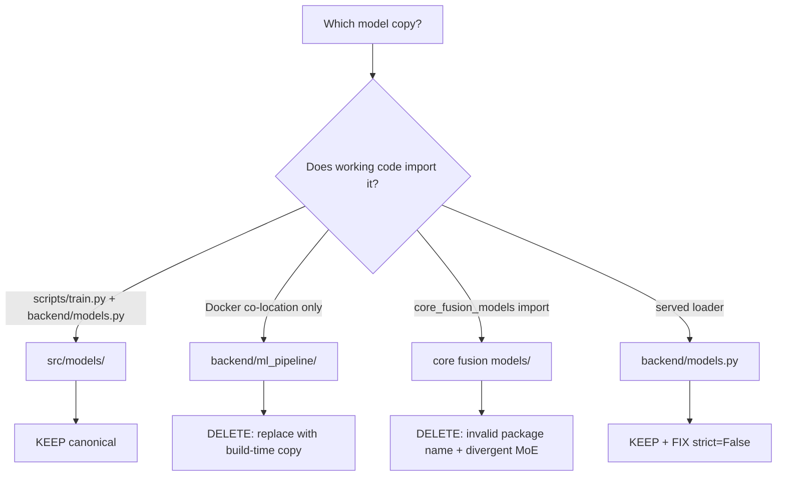

# Operational Code Audit — H5-OmniFusion

**Document standard:** ASD-STE100 Issue 9 (Simplified Technical English).
**Version:** 1.0  **Date:** 2026-11-10  **Status:** Recommendation only.
**Scope:** All code in the repository. The audit covers feature extraction AND training.

> WARNING: This document only recommends. Do not delete code, move files, or
> change code until the user gives explicit approval. Deletion is a separate,
> confirmed action. Loss of code is permanent.

---

## 1. Purpose

This audit tells you which code to keep, which code to delete, and which code
to fix. The goal is a small, operational project. The project must do two jobs:

1. Extract features from the five modalities into H5 files.
2. Train the H5-OmniFusion model on those H5 files.

The repository has 206 Python files and 38,579 lines of code (LOC). It also has
40 notebooks and 8,575 lines of notebook code. Much of this code is duplicate,
broken, or one-off scratch. This audit removes the dead weight. It keeps one
working path for each job.

---

## 2. Controlled terms

Use one term for one concept. The table defines the terms for this document.

| Term | Definition |
|------|------------|
| KEEP | The code is correct and necessary. Do not change it. |
| DELETE | The code is dead, duplicate, or broken. Remove it after approval. |
| FIX | The code is necessary but has a defect. Repair the defect. |
| ARCHIVE | Move a whole file to an archive folder. Do not delete it. |
| LOC | Lines of code. The count includes blank lines and comments. |
| Canonical | The one copy that the working code imports. |
| Vendored | A copy made for deployment. It duplicates the canonical code. |
| Divergent | A copy that has different logic from the canonical code. |
| Operational | The code runs end-to-end and gives a correct result. |
| H5 | An HDF5 feature file. It holds one participant's features and labels. |
| MoE | Mixture of Experts. The quality-gated fusion module. |
| Contract | The set of keys and shapes that two modules agree to exchange. |

Technical names, file paths, and code identifiers stay exactly as written.
ASD-STE100 permits technical names. This document does not translate them.

---

## 3. General safety rules

> WARNING: Do not delete notebook cells. The notebook rule is append-only. To
> remove a notebook from service, ARCHIVE the whole file. Do not edit its cells.

> CAUTION: The backend serves a model to users. A wrong change to the backend
> can serve random weights. Test the backend load path before you change it.

> CAUTION: Two training stacks exist. Only one is correct. If you train with
> the wrong stack, you train a dummy model. Section 8 identifies the correct one.

---

## 4. Summary charts

### 4.1 Repository totals (counted, exact)

| Asset | Files | LOC | Note |
|-------|------:|----:|------|
| Python source | 206 | 38,579 | All `.py`, excludes `.git` |
| Notebook code | 40 | 8,575 | 268 code cells |
| Frontend source | 6 | 863 | Hand-written; lockfile adds 20,175 |
| Infrastructure | 3 | — | bicep, nginx, supervisord |
| Demo samples | 38 | — | Sample data, not code |

### 4.2 Python LOC by module (bar chart)

Scale: one block ≈ 317 LOC. Tag: K = KEEP, D = DELETE, F = FIX, A = ARCHIVE.

```text
src/                     ████████████████████████████████████████ 12,681  K/F
preprocessing/           ██████████████████████████                8,170  K/D
scripts/                 █████████████████                         5,376  K/D
backend/ (root)          █████████                                 2,974  K/F
backend/ml_pipeline/     ████████                                  2,483  D
core fusion models/      ███████                                   2,325  D
training/ (top-level)    ██████                                    1,775  D
notebooks/*.py           █████                                     1,527  D
backend/_cleanup_delete/ ██                                          657  D
config/                  █                                           286  K
inference/               █                                           164  K
h5_omnifusion root *.py  █                                           161  K/D
```

### 4.3 Keep / delete split (Python LOC)

```text
KEEP   ████████████████████████  23,786 LOC  (61.7%)  105 files
DELETE ███████████████           14,793 LOC  (38.3%)  101 files
       └─ hard delete   12,310 LOC   77 files  (scratch + broken + divergent)
       └─ conditional    2,483 LOC   24 files  (Docker vendored copy)
```

The delete count removes 38% of the Python code. The working path stays whole.

---

## 5. Hierarchical tree (annotated)

The tree shows every module. Each node gives the verdict, the file count, and
the LOC. Indentation shows the hierarchy.

```text
useless/                                  [root]
├── ml_pipeline/h5_omnifusion/            KEEP core
│   ├── src/                              KEEP/FIX   60 files  12,681 LOC
│   │   ├── models/                       KEEP        canonical model (Section 8)
│   │   ├── data/                         KEEP        h5_dataset, dataset, augmentation
│   │   ├── training/                     KEEP        trainer, losses, ensemble
│   │   ├── audio/ text/ video/ face/     KEEP        preprocessing + feature_extraction
│   │   ├── tabular/ fusion/              KEEP
│   │   ├── advanced_features.py          KEEP        814 LOC feature layer
│   │   ├── dvlog_108step_features.py     KEEP        580 LOC feature layer
│   │   ├── pipeline.py                   FIX         444 LOC orchestration overlap
│   │   ├── pipeline_integration.py       FIX         460 LOC orchestration overlap
│   │   └── glass_box_108step_verifier.py KEEP-opt    412 LOC validation tool
│   ├── config/                           KEEP         3 files    286 LOC
│   ├── preprocessing_and_feature_extraction/
│   │   ├── pipeline_fusion_main.py       KEEP/FIX  1,256 LOC main extractor
│   │   ├── pipeline_video_face.py        KEEP        803 LOC
│   │   ├── pipeline_audio.py             FIX         581 LOC duplicate jitter/shimmer
│   │   ├── pipeline_text.py              KEEP        343 LOC
│   │   ├── *_enhancements.py (4)         KEEP      1,680 LOC feature layers
│   │   ├── research_layer_extensions.py  KEEP        494 LOC
│   │   └── archive/                      DELETE      3 files  3,013 LOC
│   ├── scripts/                          KEEP 12 / DELETE 20   5,376 LOC
│   │   ├── train.py                      KEEP        159 LOC correct training entry
│   │   ├── train_ensemble.py             KEEP        154 LOC
│   │   ├── evaluate_ensemble.py          KEEP        146 LOC
│   │   ├── ensemble_predict.py           KEEP        198 LOC
│   │   ├── predict.py                    KEEP         89 LOC
│   │   ├── run_all_folds.py              KEEP        114 LOC
│   │   ├── aggregate_cv_results.py       KEEP         78 LOC
│   │   ├── run_ablation_study.py         KEEP         59 LOC
│   │   ├── estimate_params.py            KEEP         29 LOC
│   │   ├── daic_preprocessing.py         KEEP        856 LOC reprocess reference
│   │   ├── Feature_Extraction_SOTA.py    KEEP        479 LOC feature reference
│   │   └── (20 one-off tools)            DELETE    3,013 LOC audit/fix/convert/pdf
│   ├── core fusion models/               DELETE     21 files  2,325 LOC divergent
│   ├── notebooks/
│   │   ├── *.ipynb (38)                  ARCHIVE 35 / KEEP 3   8,575 code LOC
│   │   └── *.py (8 mutators)             DELETE      8 files  1,527 LOC
│   ├── inference/                        KEEP        2 files    164 LOC
│   ├── results/                          KEEP        output dir (no code)
│   └── *.py (ci helpers, 4)              KEEP-opt    4 files    161 LOC
├── training/                             DELETE     10 files  1,775 LOC broken stack
├── backend/                              KEEP/FIX  serving (optional for demo)
│   ├── *.py (root, 15)                   KEEP/FIX   15 files  2,974 LOC
│   │   └── models.py                     FIX        338 LOC strict=False load
│   ├── ml_pipeline/                      DELETE     24 files  2,483 LOC vendored
│   ├── database/                         KEEP        schema (no .py)
│   └── _cleanup_delete/                  DELETE     15 files    657 LOC scratch
├── frontend/                             KEEP        6 files    863 LOC demo UI
├── infrastructure/                       KEEP        3 files    deploy configs
├── demo_samples/                         KEEP       38 files    sample data
├── docs/ml_pipeline/                     KEEP        spec + architecture
├── DEEP_FEATURE_EXTRACTION_CATALOG.md    KEEP        feature catalog
├── FINAL_200_FEATURE_SCHEMA.md           KEEP        collision-free schema
├── FUSION_DERIVED_REPLACEMENTS.md        KEEP        replacement logic
├── AGENTS.md                             KEEP        project rules
└── DAIC-WOZ_Datasets-*.zip               KEEP        126 MB input data
```

---

## 6. Module table (files + LOC + verdict)

| Module | Files | LOC | Verdict | Reason |
|--------|------:|----:|---------|--------|
| `src/` | 60 | 12,681 | KEEP/FIX | Canonical model, data, training, features |
| `preprocessing_and_feature_extraction/` | 12 | 8,170 | KEEP 9 / DELETE 3 | Main extractor; archive is dead |
| `scripts/` | 32 | 5,376 | KEEP 12 / DELETE 20 | Training entry; one-off tools are dead |
| `backend/` root | 15 | 2,974 | KEEP/FIX | Serving API; one load defect |
| `backend/ml_pipeline/` | 24 | 2,483 | DELETE | Byte-identical Docker vendored copy |
| `core fusion models/` | 21 | 2,325 | DELETE | Divergent MoE; broken import target |
| `training/` top-level | 10 | 1,775 | DELETE | Broken stack; wrong contract |
| `notebooks/*.py` | 8 | 1,527 | DELETE | One-off notebook mutators |
| `backend/_cleanup_delete/` | 15 | 657 | DELETE | Test scratch and result dumps |
| `config/` | 3 | 286 | KEEP | H5Config + TrainingConfig |
| `inference/` | 2 | 164 | KEEP | Predict support |
| `h5_omnifusion` root `.py` | 4 | 161 | KEEP-opt | CI helpers |
| **Python total** | **206** | **38,579** | — | — |

---

## 7. The operational core (KEEP)

Two paths make the project operational. Keep both. They share the canonical
model in `src/models/`.

### 7.1 Data flow diagram

```mermaid
flowchart LR
    A[Raw audio/text/video/face/tabular] --> B[preprocessing_and_feature_extraction]
    B --> C[200-feature H5 + reliability flags]
    C --> D[src/data/h5_dataset.py]
    D --> E[scripts/train.py]
    E --> F[src/models/h5_omnifusion.py]
    F --> G[src/training/trainer.py]
    G --> H[Trained checkpoint .pt]
    H --> I[backend/models.py]
    I --> J[backend/main.py API]
    J --> K[frontend demo]
```



### 7.2 Feature-extraction path (KEEP)

- `preprocessing_and_feature_extraction/pipeline_fusion_main.py` — main entry.
- `pipeline_audio.py`, `pipeline_text.py`, `pipeline_video_face.py` — modality workers.
- `*_enhancements.py` and `research_layer_extensions.py` — deep feature layers.
- `src/advanced_features.py` and `src/dvlog_108step_features.py` — feature signals.
- Output contract: the 200-feature schema in `FINAL_200_FEATURE_SCHEMA.md`.

### 7.3 Training path (KEEP)

- Entry: `scripts/train.py` (159 LOC). It imports the canonical model.
- Model: `src/models/h5_omnifusion.py`. It takes one `config` object.
- Trainer: `src/training/trainer.py` (494 LOC). It reads the correct keys.
- Data: `src/data/h5_dataset.py` (620 LOC). It loads H5 and makes k-fold loaders.
- Config: `config/model_config.py` and `config/training_config.py`.

The trainer reads `outputs['binary_logit']` and `outputs['phq_score']`. The model
emits these exact keys at `src/models/heads/output_heads.py:61` and `:66`. The
contract matches. This path is correct.

> CAUTION: Run training from the `ml_pipeline/h5_omnifusion/` directory. The
> entry uses `from src...` and `from config...`. These imports need that directory
> on the path. A wrong working directory causes an import error.

---

## 8. The four model copies (decision)

The repository holds four copies of the model. Only one is canonical. The
others are duplicate, divergent, or broken.

### 8.1 Copy table

| Copy | Files | LOC | MoE LOC | MoE classes | Used by | Verdict |
|------|------:|----:|--------:|------------:|---------|---------|
| `src/models/` | — | — | 113 | 5 | `scripts/train.py`, `backend/models.py:127` | KEEP canonical |
| `backend/ml_pipeline/.../src/models/` | 24 | 2,483 | 113 | 5 | Docker fallback only | DELETE vendored |
| `core fusion models/` | 21 | 2,325 | 214 | 3 | nothing that works | DELETE divergent |
| `backend/models.py` loader | 1 | 338 | — | — | `backend/main.py:26` | KEEP/FIX loader |

### 8.2 Decision diagram



### 8.3 Why the top-level `training/` stack fails

The top-level `training/` package is broken in three independent ways. Each
one alone prevents correct training.

1. **Impossible import.** `training/scripts/train.py:72` does
   `from core_fusion_models.h5_omnifusion import H5OmniFusion`. The real directory
   is `core fusion models` with spaces. A space is not valid in a Python package
   name. The import always fails. The code falls back to `DummyModel`.
2. **Wrong output contract.** `training/src/losses.py:199` and
   `training/src/trainer.py:211` read `binary_logits` and `phq8_pred`. The real
   model emits `binary_logit` and `phq_score`. Even with a working import, every
   batch raises a KeyError.
3. **Wrong constructor signature.** `training/scripts/train.py:74` calls
   `H5OmniFusion(d_model=..., n_heads=..., ...)`. The real model takes one
   `config` object (`src/models/h5_omnifusion.py:34`). The call cannot construct
   the real model.

Verdict: DELETE the whole top-level `training/` package (10 files, 1,775 LOC).
Use `scripts/train.py` with `src/training/` instead. Do not fix the broken stack.
The correct stack already exists.

---

## 9. DELETE list (after approval)

Remove these groups. Each group is dead, duplicate, or broken. The LOC column
gives the reclaimed code.

### 9.1 Hard delete — scratch, broken, divergent

| Group | Files | LOC | Reason |
|-------|------:|----:|--------|
| `backend/_cleanup_delete/` | 15 | 657 | Test scratch and `res_*.txt` dumps |
| `preprocessing_and_feature_extraction/archive/` | 3 | 3,013 | Superseded complete-pipeline copies |
| `core fusion models/` | 21 | 2,325 | Divergent MoE; invalid import target |
| `training/` top-level | 10 | 1,775 | Broken stack (Section 8.3) |
| `notebooks/*.py` mutators | 8 | 1,527 | One-off notebook generators/fixers |
| `scripts/` one-off tools | 20 | 3,013 | audit/fix/convert/pdf/compliance scratch |
| `*.resolved`, `__pycache__/*.pyc` | 4 | — | Merge artifact and bytecode (not Python source) |
| **Hard-delete subtotal** | **77 .py + 4 artifacts** | **12,310** | — |

Note: LOC counts Python source only. The `backend/_cleanup_delete/` folder also
holds 20 `res_*.txt` result dumps. Deleting the whole folder removes 35 files,
but only 15 are Python (657 LOC). The 4 artifacts are not part of the 206 Python
files in Section 4.

The 20 one-off scripts include: `quick_fix_implementation.py` (545),
`convert_docs_to_pdf.py` (298), `audit_300.py` (260), `audit_108_strict.py` (250),
`combine_and_convert_to_pdf.py` (203), `analyze_h5.py` (197),
`plot_publication_figures.py` (137), `verify_pipeline.py` (135),
`compliance_check.py` (134), `feature_list_108.py` (123), `fix_compliance.py` (122),
`test_extraction_local.py` (112), `colab_quickstart.py` (101),
`convert_folder_report.py` (90), `check108.py` (80), `verify_tabular_augment.py` (77),
`verify_dataset.py` (77), `fix_nltk.py` (43), `simple_dump.py` (16),
`extract_batch_report.py` (13).

### 9.2 Conditional delete — Docker vendored copy

| Group | Files | LOC | Condition |
|-------|------:|----:|-----------|
| `backend/ml_pipeline/` | 24 | 2,483 | Delete if the Docker backend is out of scope. Otherwise replace with a build-time copy of `src/models/` + `config/`. |

`backend/models.py:24` points to the canonical `ml_pipeline/`. Line 27 falls back
to `backend/ml_pipeline/` only for Docker co-location. The copy is byte-identical
(MoE 113 LOC = 113 LOC). A build-time copy removes the drift risk.

### 9.3 ARCHIVE — notebooks (do not delete cells)

> WARNING: The notebook rule is append-only. Do not delete or edit cells. Move
> whole notebook files to `notebooks/_archive/`. This keeps the work recoverable.

- KEEP 3 notebooks: `H5_OmniFusion_Colab_Runner.ipynb`,
  `H5_OmniFusion_Training_Colab.ipynb`, `OmniFusion_Model_Picker.ipynb`.
- ARCHIVE 35 notebooks: all `Phase7`–`Phase13` folds, `Best_Model_*`,
  `EATD_*`, `LMVD_*`, `Checkpoint_Evaluator`, and other one-off phase notebooks.
- Notebook code reclaimed from service: ~8,575 LOC across 40 files. The 3 kept
  notebooks hold the operational runner, training, and model-picker flows.

### 9.4 Reclaim chart

```text
DELETE hard       ████████████████████  12,310 LOC
DELETE conditional████                   2,483 LOC
ARCHIVE notebooks ██████████████         8,575 code LOC (moved, not deleted)
KEEP              ████████████████████████████████████████  23,786 py LOC
```

---

## 10. FIX list (necessary code with defects)

These defects block correct operation. Repair them. Each item gives evidence.

### 10.1 Backend silent weight load

- **File:** `backend/models.py:166`.
- **Defect:** `model.load_state_dict(sd, strict=False)`. The code logs the count
  of missing keys but does not stop. A partial load serves a model with random
  weights in the unloaded layers.
- **Fix:** Fail loud. Raise an error if `missing_keys` or `unexpected_keys` is
  non-empty, unless an explicit whitelist permits the gap.

> WARNING: A silent partial load can serve random MoE weights to users. The
> result looks valid but is not trained. Verify the load before you serve.

### 10.2 Duplicate jitter/shimmer computation

- **File:** `preprocessing_and_feature_extraction/pipeline_audio.py`.
- **Defect:** `EGeMAPSExtractor` (line 281) and `JitterShimmerAnalyzer` (line 368)
  both compute jitter and shimmer. The two values collide.
- **Fix:** Keep one source. The 200-feature schema already resolves this collision
  with a fusion-derived replacement. Emit one jitter and one shimmer column.

### 10.3 Degenerate features from the previous run

- **Evidence (prior audit):** E-DAIC three modalities are 100% zero. DAIC text
  vectors are cosine-identical (≥0.99). DAIC video and face are random noise.
  The `au` block duplicates the `face` block. Gaze is zero. Some files are NaN.
- **Fix:** Reprocess with the 200-feature schema. Emit NaN plus a reliability
  flag for an absent modality. Never emit a silent zero. This is the Colab redo.

### 10.4 H5 key contract (integration checkpoint)

- **Files:** the new H5 writer and `src/data/h5_dataset.py` (620 LOC).
- **Task:** Confirm the writer emits the dataset keys that the loader reads.
  Confirm the 200-feature width matches the model input. Confirm the label join.
- **Fix:** Add a write-time schema check. Reject a file with a wrong key or shape.

### 10.5 Orchestration overlap

- **Files:** `src/pipeline.py` (444), `src/pipeline_integration.py` (460), and
  `preprocessing_and_feature_extraction/pipeline_fusion_main.py` (1,256).
- **Defect:** Three orchestration entries overlap. The correct entry is unclear.
- **Fix:** Choose `pipeline_fusion_main.py` as the single extraction entry. Mark
  the other two as legacy or remove them after approval.

---

## 11. Operational procedure

Follow these steps to make the project operational. Do the steps in order.

### 11.1 Prepare the code (after approval)

1. Archive the 35 one-off notebooks. Move whole files. Do not edit cells.
2. Delete the hard-delete groups in Section 9.1.
3. Delete or replace the Docker vendored copy (Section 9.2).
4. Apply the FIX items in Section 10.1, 10.2, and 10.5.

> CAUTION: Make a backup or a git commit before you delete. Confirm the working
> tree is clean. A delete without a backup is permanent.

### 11.2 Extract features (Colab)

1. Mount Google Drive. Use the base path in `AGENTS.md`.
2. Download the dataset in batches. Stream each batch to Drive.
3. Run the GPU phase. Extract encoder embeddings. Save each batch to Drive.
4. Switch to the CPU runtime. Run the Rust kernel and the scalar features.
5. Assemble the 200-feature H5 files. Write a reliability flag for each feature.
6. Write to a new dated Drive folder. Use a manifest and atomic writes.

> WARNING: A Colab VM can disconnect at any time. Save each batch to Drive as it
> completes. Do not hold completed work only on the VM disk.

### 11.3 Train the model (Colab)

1. Change to the `ml_pipeline/h5_omnifusion/` directory.
2. Run `scripts/train.py`. Point `--data_dir` at the new H5 folder.
3. Point `--labels_csv` at the consolidated labels.
4. The entry loads `src/models/h5_omnifusion.py` with a `config` object.
5. The trainer reads `binary_logit` and `phq_score`. The contract matches.
6. Save each checkpoint to Drive. Resume from the last checkpoint after a restart.

> CAUTION: Do not use the top-level `training/` package. It trains a dummy model.
> Use `scripts/train.py` only. Section 8.3 gives the evidence.

### 11.4 Serve the model (optional demo)

1. Apply the FIX in Section 10.1 to `backend/models.py`.
2. Load the trained checkpoint. Verify zero missing keys.
3. Start `backend/main.py`. Test one prediction end-to-end.
4. Connect the frontend. Confirm the demo returns a trained result.

---

## 12. Verification checklist

Use this list to confirm the project is operational.

- [ ] One model copy remains canonical (`src/models/`).
- [ ] The top-level `training/` package is gone.
- [ ] `scripts/train.py` imports the real model, not `DummyModel`.
- [ ] The trainer reads `binary_logit` and `phq_score` without a KeyError.
- [ ] The backend load raises on missing keys (no silent partial load).
- [ ] One jitter column and one shimmer column exist (no duplicate).
- [ ] The H5 writer emits the 200-feature schema with reliability flags.
- [ ] Absent modalities are NaN, not zero.
- [ ] The dataset loader reads the new H5 keys and the correct width.
- [ ] The label join is correct for DAIC, E-DAIC, and EATD.
- [ ] Each Drive batch survives a VM restart (manifest + atomic write).
- [ ] One extraction entry remains (`pipeline_fusion_main.py`).
- [ ] Notebook cells are unchanged. One-off notebooks are archived, not edited.

---

## Appendix A — Per-file LOC (counted, exact)

### A.1 `src/` (60 files, 12,681 LOC) — top entries

| File | LOC |
|------|----:|
| `advanced_features.py` | 814 |
| `data/h5_dataset.py` | 620 |
| `dvlog_108step_features.py` | 580 |
| `text/feature_extraction.py` | 528 |
| `audio/feature_extraction.py` | 511 |
| `training/trainer.py` | 494 |
| `face/feature_extraction.py` | 484 |
| `pipeline_integration.py` | 460 |
| `pipeline.py` | 444 |
| `glass_box_108step_verifier.py` | 412 |
| `text/preprocessing.py` | 377 |
| `audio/preprocessing.py` | 377 |
| `video/preprocessing.py` | 376 |
| `data/dataset.py` | 370 |
| `utils.py` | 369 |
| `face/detection.py` | 358 |
| `audio/advanced.py` | 333 |
| `fusion/advanced.py` | 317 |
| `model_loader.py` | 299 |
| `tabular/preprocessing.py` | 297 |
| `config.py` | 290 |
| `fusion/cross_modal.py` | 283 |
| `video/feature_extraction.py` | 266 |
| `models/encoders/video_encoder.py` | 262 |
| `audio/diarization.py` | 260 |
| `models/components/kan_layer.py` | 228 |
| `text/chinese_support.py` | 212 |
| `models/h5_omnifusion.py` | 209 |
| `models/components/mamba_block.py` | 188 |
| `models/encoders/text_encoder.py` | 183 |
| `models/encoders/audio_encoder.py` | 183 |
| `models/fusion/latent_perceiver.py` | 157 |
| `training/ensemble.py` | 128 |
| `models/fusion/ms2_decomposition.py` | 115 |
| `models/experts/moe_gating.py` | 113 |
| `models/encoders/face_encoder.py` | 109 |
| `models/encoders/tabular_encoder.py` | 101 |
| `models/fusion/local_hypergraph.py` | 89 |
| `models/heads/output_heads.py` | 74 |
| `models/fusion/modality_hypergraph.py` | 69 |
| `models/experts/modality_experts.py` | 62 |
| `data/augmentation.py` | 57 |
| `training/losses.py` | 55 |
| `evaluation/metrics.py` | 42 |
| `utils/seed.py` | 24 |
| (15 `__init__.py` files) | 100 |

### A.2 `preprocessing_and_feature_extraction/` (12 files, 8,170 LOC)

| File | LOC | Verdict |
|------|----:|---------|
| `archive/H5_OmniFusion_Complete_Pipeline.py` | 2,288 | DELETE |
| `pipeline_fusion_main.py` | 1,256 | KEEP/FIX |
| `pipeline_video_face.py` | 803 | KEEP |
| `pipeline_audio.py` | 581 | FIX |
| `fusion_enhancements.py` | 519 | KEEP |
| `research_layer_extensions.py` | 494 | KEEP |
| `video_face_enhancements.py` | 474 | KEEP |
| `archive/complete_pipeline.py` | 447 | DELETE |
| `audio_enhancements.py` | 380 | KEEP |
| `pipeline_text.py` | 343 | KEEP |
| `text_enhancements.py` | 307 | KEEP |
| `archive/eatd_corpus_processor.py` | 278 | DELETE |

### A.3 `scripts/` (32 files, 5,376 LOC)

| File | LOC | Verdict |
|------|----:|---------|
| `daic_preprocessing.py` | 856 | KEEP |
| `quick_fix_implementation.py` | 545 | DELETE |
| `Feature_Extraction_SOTA.py` | 479 | KEEP |
| `convert_docs_to_pdf.py` | 298 | DELETE |
| `audit_300.py` | 260 | DELETE |
| `audit_108_strict.py` | 250 | DELETE |
| `combine_and_convert_to_pdf.py` | 203 | DELETE |
| `ensemble_predict.py` | 198 | KEEP |
| `analyze_h5.py` | 197 | DELETE |
| `train.py` | 159 | KEEP |
| `train_ensemble.py` | 154 | KEEP |
| `evaluate_ensemble.py` | 146 | KEEP |
| `plot_publication_figures.py` | 137 | DELETE |
| `verify_pipeline.py` | 135 | DELETE |
| `compliance_check.py` | 134 | DELETE |
| `feature_list_108.py` | 123 | DELETE |
| `fix_compliance.py` | 122 | DELETE |
| `run_all_folds.py` | 114 | KEEP |
| `test_extraction_local.py` | 112 | DELETE |
| `colab_quickstart.py` | 101 | DELETE |
| `convert_folder_report.py` | 90 | DELETE |
| `predict.py` | 89 | KEEP |
| `check108.py` | 80 | DELETE |
| `aggregate_cv_results.py` | 78 | KEEP |
| `verify_tabular_augment.py` | 77 | DELETE |
| `verify_dataset.py` | 77 | DELETE |
| `run_ablation_study.py` | 59 | KEEP |
| `fix_nltk.py` | 43 | DELETE |
| `estimate_params.py` | 29 | KEEP |
| `simple_dump.py` | 16 | DELETE |
| `extract_batch_report.py` | 13 | DELETE |
| `__init__.py` | 2 | KEEP |

### A.4 `backend/` root (15 files, 2,974 LOC)

| File | LOC | Verdict |
|------|----:|---------|
| `main.py` | 662 | KEEP |
| `models.py` | 338 | FIX |
| `cache.py` | 270 | KEEP |
| `storage.py` | 243 | KEEP |
| `inference_preprocessing.py` | 217 | KEEP |
| `hf_client.py` | 207 | KEEP |
| `resilience.py` | 205 | KEEP |
| `vector_store.py` | 197 | KEEP |
| `database.py` | 164 | KEEP |
| `schemas.py` | 113 | KEEP |
| `middleware.py` | 112 | KEEP |
| `eval_all.py` | 94 | KEEP |
| `verify_load.py` | 71 | KEEP |
| `config.py` | 70 | KEEP |
| `query_db.py` | 11 | KEEP |

### A.5 `training/` top-level (10 files, 1,775 LOC) — DELETE all

| File | LOC |
|------|----:|
| `src/trainer.py` | 378 |
| `src/losses.py` | 303 |
| `src/dataset.py` | 270 |
| `src/checkpointing.py` | 247 |
| `scripts/train.py` | 213 |
| `config/training_config.py` | 211 |
| `src/metrics.py` | 141 |
| `src/__init__.py` | 6 |
| `__init__.py` | 4 |
| `config/__init__.py` | 2 |

### A.6 `core fusion models/` (21 files, 2,325 LOC) — DELETE all

| File | LOC |
|------|----:|
| `encoders/video_encoder.py` | 262 |
| `components/mamba_block.py` | 230 |
| `components/kan_layer.py` | 228 |
| `experts/moe_gating.py` | 214 |
| `h5_omnifusion.py` | 209 |
| `encoders/text_encoder.py` | 183 |
| `encoders/audio_encoder.py` | 180 |
| `fusion/latent_perceiver.py` | 157 |
| `fusion/ms2_decomposition.py` | 115 |
| `encoders/face_encoder.py` | 102 |
| `encoders/tabular_encoder.py` | 98 |
| `fusion/local_hypergraph.py` | 89 |
| `heads/output_heads.py` | 74 |
| `fusion/modality_hypergraph.py` | 69 |
| `experts/modality_experts.py` | 60 |
| (6 `__init__.py` files) | 55 |

---

*End of audit. This document recommends only. Await user approval before any
delete, move, or code change.*