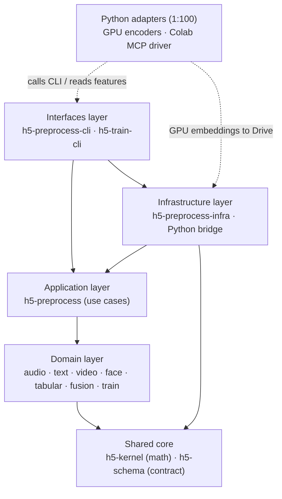
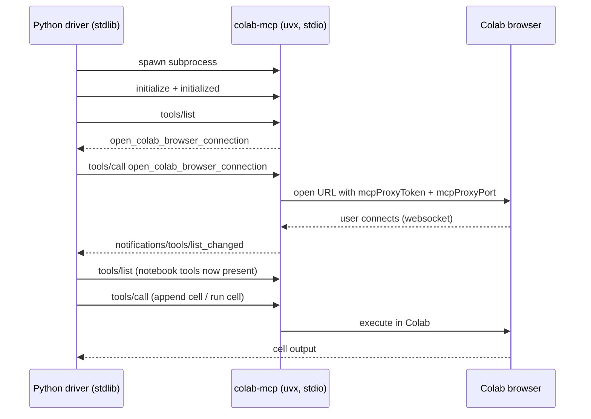

# Rust DDD Asset Plan — H5-OmniFusion Redo

> **Timestamp:** 2026-11-11 · **Branch:** `redo/rust-ddd` · **Status:** scaffold built and tested
> **Style:** ASD-STE100 Issue 9 (Simplified Technical English)

---

## 1. Purpose

This plan defines the code assets for the H5-OmniFusion redo. It sets the folder
architecture, the crate map, and the build rules. It separates preprocessing from
training. It records the real file counts and the test results.

The plan recommends the structure. The user makes the final decisions.

---

## 2. Glossary

| Term | Definition |
|------|------------|
| DDD | Domain-Driven Design. The code follows the problem domain, not the framework. |
| Bounded context | A clear boundary around one part of the domain (for example, audio). |
| SOLID | Five object-oriented rules: SRP, OCP, LSP, ISP, DIP. See Section 8. |
| Hexagonal | Ports and adapters. The domain defines ports; adapters plug into them. |
| Port | A trait that the domain owns. It names a need, not an implementation. |
| Adapter | Code that implements a port (for example, a CSV writer). |
| Crate | One Rust package. Each crate builds on its own. |
| Kernel | The shared pure-math crate `h5-kernel`. It has no I/O. |
| Primitive | A direct hand-computed feature (156 of the 200). |
| Fusion feature | A two-modality interaction with the `fx_` prefix (44 of the 200). |
| Reliability flag | A tag on each value: `Exact`, `Proxy`, or `Absent`. |
| WOOOPS | The user's name for the strict architecture discipline. See Section 9. |

---

## 3. The hard rules (user mandates)

> WARNING: These rules are mandatory. Do not break them.

1. Use Rust wherever possible. Use Python only when Rust needs about 100 times
   more lines (a 1:100 or 2:100 ratio). GPU inference is the main Python case.
2. Keep every file under 500 lines.
3. Use a detailed DDD folder architecture.
4. Maintain separate crates. A plain `cargo build` must work.
5. Follow SOLID and the hexagonal discipline strictly.
6. Keep preprocessing (feature extraction) separate from training.
7. Create the folder structure first. Then code step by step.
8. Produce no runtime errors. Build and test before you report done.
9. Drive Google Colab through the Colab MCP, programmatically.

---

## 4. Architecture overview

The architecture has four layers. The dependency rule points inward only.
The domain depends on nothing outward. Adapters depend on the domain.



- The core (`h5-kernel`, `h5-schema`) has no external crates. It is std-only.
- The domain crates use the core. They define ports and pure extractors.
- The application crate orchestrates the domain through ports.
- The infrastructure and interface crates do I/O. They are the outer ring.
- Python is an outer adapter. It calls the Rust CLI and reads its output.

---

## 5. Two separated areas

> WARNING: Do not mix training code into feature extraction. Keep them apart.

| Area | Folder | Purpose | Runtime |
|------|--------|---------|---------|
| Preprocessing | `rust/crates/preprocess/` | Extract the 200 features from raw inputs. | CPU |
| Training | `rust/crates/train/` + `bridge/training/` | Fit and score the model. | GPU (Python) |
| Shared core | `rust/crates/h5-kernel`, `rust/crates/h5-schema` | Math and the feature contract. | CPU |

The preprocessing area produces feature files. The training area consumes them.
They share only the core. They do not call each other's internals.

---

## 6. Crate map (13 crates)

| Crate | Area | Layer | Responsibility | Depends on | LOC |
|-------|------|-------|----------------|------------|-----|
| `h5-kernel` | shared | core | stats, selective scan, quality gate | — | 253 |
| `h5-schema` | shared | core | 200-feature contract, NaN + flag | — | 346 |
| `h5-audio` | preprocess | domain | F0, loudness, pause extractors | kernel, schema | 28 |
| `h5-text` | preprocess | domain | lexical ratio extractors | kernel, schema | 26 |
| `h5-video` | preprocess | domain | motion, quality extractors | kernel, schema | 25 |
| `h5-face` | preprocess | domain | action-unit extractors | kernel, schema | 25 |
| `h5-tabular` | preprocess | domain | session-metadata extractors | kernel, schema | 18 |
| `h5-fusion` | preprocess | domain | the `fx_*` interaction operator | kernel, schema | 29 |
| `h5-preprocess` | preprocess | application | use cases over the domains | all 6 domains + core | 33 |
| `h5-preprocess-infra` | preprocess | infrastructure | CSV output, atomic Drive write | schema | 34 |
| `h5-preprocess-cli` | preprocess | interfaces | thin binary over the use cases | app, infra, schema | 28 |
| `h5-train` | train | domain | MAE, MSE, F1 metrics (pure) | kernel | 41 |
| `h5-train-cli` | train | interfaces | offline metric scoring binary | train | 14 |

> NOTE: The domain crates are seeded with one real extractor and a test each.
> Section 16 lists the extractors to add next. The seeds compile and pass.

---

## 7. Folder tree (verified)

```
rust/
├── Cargo.toml                      # workspace: 13 members
├── .gitignore                      # /target, *.tmp
├── README.md
├── crates/
│   ├── h5-kernel/                  # shared core: pure math
│   │   ├── Cargo.toml
│   │   └── src/
│   │       ├── lib.rs
│   │       ├── stats.rs            # mean, std, pearson, spearman
│   │       ├── scan.rs             # Mamba S6 selective scan
│   │       └── quality.rs          # ADV8 consensus gate
│   ├── h5-schema/                  # shared core: feature contract
│   │   ├── Cargo.toml
│   │   └── src/
│   │       ├── lib.rs              # Modality, Kind
│   │       ├── feature.rs          # FeatureId, FeatureValue
│   │       ├── reliability.rs      # Exact / Proxy / Absent
│   │       └── catalog.rs          # the 200 IDs (generated)
│   ├── preprocess/                 # FEATURE EXTRACTION (separate)
│   │   ├── h5-audio/
│   │   ├── h5-text/
│   │   ├── h5-video/
│   │   ├── h5-face/
│   │   ├── h5-tabular/
│   │   ├── h5-fusion/
│   │   ├── h5-preprocess/          # application use cases
│   │   ├── h5-preprocess-infra/    # adapters: CSV, atomic write
│   │   └── h5-preprocess-cli/      # binary
│   └── train/                      # TRAINING (separate)
│       ├── h5-train/               # pure metrics
│       └── h5-train-cli/           # binary
└── bridge/                         # Python adapters (1:100 exception)
    └── README.md
```

---

## 8. SOLID mapping

| Rule | Meaning | How the workspace applies it |
|------|---------|------------------------------|
| SRP | One reason to change. | Each crate owns one bounded context or one layer. |
| OCP | Open to extend, closed to modify. | Add a new extractor behind a port; do not edit the core. |
| LSP | Subtypes honor the contract. | Any `ParticipantInput` adapter works in the use case. |
| ISP | Small, focused interfaces. | Ports are narrow: `PitchSource`, `MotionSource`, `AuSource`. |
| DIP | Depend on abstractions. | The application depends on port traits, not on adapters. |

---

## 9. Hexagonal discipline (WOOOPS)

> NOTE: I read "WOOOPS" as your name for strict ports-and-adapters / clean
> architecture. Correct me if you mean a specific published pattern.

The discipline has three rules:

1. The domain owns the ports (traits). The domain never imports an adapter.
2. Adapters implement ports. I/O lives only in the outer ring.
3. The dependency arrow points inward. The core knows nothing outward.

The current seeds follow this. `h5-preprocess` defines `ParticipantInput`.
The CLI supplies a concrete input. The infra crate writes the output.

---

## 10. Rust versus Python (the 1:100 rule)

| Task | Language | Reason |
|------|----------|--------|
| Scalar statistics, correlation | Rust | A few lines; pure math. |
| Mamba selective scan kernel | Rust | Tight loop; std-only; fast. |
| The 200-feature extractors | Rust | Pure functions over slices. |
| The `fx_*` fusion operator | Rust | Pure math. |
| CSV output, atomic Drive write | Rust | std `fs` is short and safe. |
| Metrics (MAE, MSE, F1) | Rust | A few lines. |
| GPU encoders (Wav2Vec2, RoBERTa, VideoMAE, POSTER) | Python | PyTorch/HuggingFace. Rust would need 100x more lines. |
| Colab MCP driver | Python | A stdio JSON-RPC client is ~100 lines; Rust would be far larger. |
| Model training loop | Python | PyTorch autograd and GPU. The 1:100 exception. |

> WARNING: Do not rewrite GPU inference in Rust. It breaks the 1:100 rule and
> adds risk. Keep PyTorch for the encoders and the training loop.

---

## 11. File-size budget

The limit is 500 lines per file. The current largest file is `catalog.rs` at
238 lines. All 19 Rust files are under the limit.

| Metric | Value |
|--------|-------|
| Rust files | 19 |
| Total Rust LOC | 900 |
| Largest file | `h5-schema/src/catalog.rs` (238 lines) |
| Files over 500 lines | 0 |
| Cargo manifests | 14 (13 crates + 1 workspace) |

---

## 12. Feature schema contract

The contract is the collision-free 200-feature schema. The source is
`FINAL_200_FEATURE_SCHEMA.md`. The catalog is generated from that file.

- 156 primitives + 44 fusion features = 200.
- Each value carries a reliability flag: `Exact`, `Proxy`, or `Absent`.
- An absent modality emits NaN + `Absent`. It never emits a silent zero.
- A unit test asserts the totals (200 / 156 / 44). The test passes.

---

## 13. Colab MCP programmatic run path

The Colab MCP is `googlecolab/colab-mcp` (v1.0.1). It runs through
`uvx git+https://github.com/googlecolab/colab-mcp`. It is a bridge, not a trainer.
It is cached locally and verified present.

> WARNING: The bridge needs a browser connection. The user must connect within
> 60 seconds. Only one client may connect at a time.

The programmatic sequence:



Steps:

1. The driver spawns the MCP server as a subprocess over stdio.
2. The driver sends `initialize`, then `notifications/initialized`.
3. The driver calls `open_colab_browser_connection`. The server opens a browser.
4. The user connects in the browser. The server sends `tools/list_changed`.
5. The driver lists the tools again. The notebook tools appear (names are dynamic).
6. The driver appends and runs cells. The real work runs in Colab.

> WARNING: Do not invent the notebook tool names. They are injected at runtime.
> Read them from `tools/list` after the connection.

> NOTE: Qoder is not a listed Colab MCP client. The driver speaks JSON-RPC
> directly, so it does not rely on Qoder's native MCP support.

---

## 14. Build and test (verified)

Run these commands from the `rust/` folder:

```
cargo build
cargo test
```

Verified results on 2026-11-11 (local Windows, GNU toolchain):

| Check | Result |
|-------|--------|
| `cargo build` | Finished, 13 crates, no errors |
| `cargo test` | 31 passed, 0 failed |
| Catalog totals test | 200 / 156 / 44 confirmed |
| `h5-preprocess-cli --demo` | wrote CSV: AUD-005=0.073 (Exact), VID-005=0.75 (Exact) |
| `h5-train-cli --metrics-demo` | MAE=0.3333, MSE=0.3333 |

> NOTE: The local default toolchain is `stable-x86_64-pc-windows-gnu`. The MSVC
> toolchain has no Visual Studio linker here. Do not pin `channel = "stable"` in
> a `rust-toolchain.toml`; it selects MSVC and fails to link. The GNU toolchain
> links with the installed WinLibs `gcc`. This stays portable to Colab Linux.

---

## 15. Provenance

| Source | Use |
|--------|-----|
| `FINAL_200_FEATURE_SCHEMA.md` | The 200 feature IDs; generated `catalog.rs`. |
| `FEATURE_FEASIBILITY_MATRIX_ASD-STE100.md` | Which features are possible on E-DAIC. |
| `COLAB_ENVIRONMENT_INVENTORY_ASD-STE100.md` | The Colab runtime facts (T4, Python 3.13). |
| `COLAB_EXECUTION_PLAN_ASD-STE100.md` | The download → features → train phases. |
| `colab_mcp` source (uv cache, v1.0.1) | The exact MCP tool name and connection flow. |
| `C:/Users/NITHING/.gemini/config/mcp_config.json` | The verified `uvx` launch command. |

---

## 16. Step-by-step roadmap

| Step | Asset | Status |
|------|-------|--------|
| 1 | Workspace + 13-crate DDD structure | Done (builds) |
| 2 | `h5-kernel`: stats, scan, quality | Done (15 tests) |
| 3 | `h5-schema`: contract + 200 catalog | Done (4 tests) |
| 4 | Domain seeds (one extractor each) | Done (compiles, tested) |
| 5 | Colab MCP programmatic driver | Next |
| 6 | Fill audio extractors (AUD-004…084) | Pending |
| 7 | Fill text extractors (TXT-002…061) | Pending |
| 8 | Fill video, face, tabular extractors | Pending |
| 9 | Fill the 44 `fx_*` fusion features | Pending |
| 10 | Infra: Drive manifest + batch resume | Pending |
| 11 | Python GPU encoders (the 1:100 set) | Pending |
| 12 | Python training loop (separate) | Pending |
| 13 | Run preprocessing on Colab via the MCP | Pending |

> WARNING: An audit or plan only recommends. Do not delete or change existing
> code without the user's explicit confirmation.